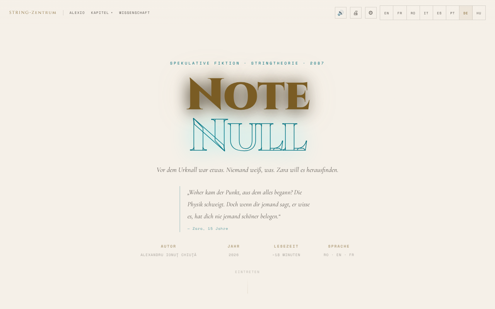

# Nota Zero

[English](README.md) · [Română](README.ro.md) · [Français](README.fr.md) · [Italiano](README.it.md) · [Español](README.es.md) · [Português](README.pt.md) · **Deutsch** · [Magyar](README.hu.md)

**Version:** 1.4.4 · **Zuletzt aktualisiert:** 2026-10-22

Oberflächensprachen: **Română, English, Français, Italiano, Español, Português (PT), Deutsch, Magyar**

**Fiktion / Spekulation.** Literarisches Werk; die wissenschaftlichen Anmerkungen dienen der Erläuterung und ersetzen keine akademischen Quellen.

Eine spekulative Kurzgeschichte über die Stringtheorie, lesbar auf 8 Sprachen (Rumänisch, Englisch, Französisch, Deutsch, Spanisch, Portugiesisch, Italienisch, Ungarisch), mit Sprachausgabe und Barrierefreiheits-Optionen.

**Online:** https://chiuta.github.io/Nota-Zero/

## Was es ist

Nota Zero ist eine Erzählung von Alexandru Ionuț Chiuță (2026), präsentiert als Ein-Datei-Leseseite (`index.html`). Laut Seite ist sie „spekulative Fiktion · Stringtheorie · 2087“, mit einer Lesezeit von etwa 18 Minuten, in acht Sprachen (RO · EN · FR · IT · ES · PT · DE · HU). Sie beginnt mit: „Vor dem Urknall war etwas. Niemand weiß, was. Zara hat vor, es herauszufinden.“ Der vollständige Text ist in der Datei enthalten, zusammen mit wissenschaftlichen Anmerkungen.

## Funktionen

- Oberfläche und vollständiger Text in 8 Sprachen (RO, EN, FR, IT, ES, PT, DE, HU): Die Erzählung (9 Kapitel) und die „Wissenschaftlichen Anmerkungen“ gibt es in jeder Sprache; die Übersetzungen ins Italienische, Spanische, Portugiesische, Deutsche und Ungarische entstanden mit KI-Unterstützung und wurden nicht von Muttersprachlern geprüft; sofortiger Wechsel zwischen den Sprachen.
- Kapitel: I · Die falsche Frage, Zwischenspiel · Der Vater, II · Die Musik vor den Klängen, III · Die Membran, IV · Vor der ersten Sekunde, V · Die Saiten, VI · Der Spiegel des Universums, VII · Die Rückkehr, Epilog · 17. Mai 2087, dazu der Abschnitt „Wissenschaftliche Anmerkungen“.
- Menü „Kapitel“ mit Direktnavigation; Schaltfläche „↑“ zur Rückkehr nach oben; mobiles Menü.
- Vorlesen (🔊) über die Sprachsynthese des Browsers (Web Speech API): ▶-Schaltfläche bei jedem Kapitel, Player mit Pause, Stopp, Sprung zwischen Abschnitten, Geschwindigkeit (1×) und Stimmauswahl.
- Drucken (🖨).
- „Lesen fortsetzen“: Bei einem erneuten Besuch erscheint, wenn du zuvor über das erste Kapitel hinaus gelesen hast, eine dezente Leiste „Du bist stehen geblieben bei …“ mit den Schaltflächen Fortsetzen und Schließen (sie folgt der gewählten Sprache).
- Barrierefreiheits-Panel (⚙): Textgröße (A− / A+), Schrift für Legasthenie (Atkinson Hyperlegible), Abstand von Buchstaben/Wörtern/Zeilen/Absätzen, Textschatten, schmale Spalte, Unterstreichen von Links, hoher Kontrast, heller Modus, Sepia-Modus (hellbeiger Hintergrund mit braunem Text), keine Animationen, Lesehilfe, Modi für Farbfehlsichtigkeit (Protanopie, Deuteranopie, Tritanopie) und „Alle Einstellungen zurücksetzen“.
- Hintergrundanimation (Canvas) im Kopfbereich, die sich unter „Keine Animationen“ abschalten lässt.

## Weitere Dateien

- `index.md` — der Text der Erzählung im Markdown-Format (rumänische Fassung).
- `recenzie.html` — eine „Erschöpfende Rezension“ des Werks, **erzeugt von einem KI-Modell (Claude Sonnet 4.6)**, keine unabhängige Literaturkritik; die Bewertungen (z. B. 9,4/10) werden automatisch erzeugt und wurden nicht von einer menschlichen Bewertung geprüft. Das Etikett „Recenzie generată de AI / AI-generated review“ wird zweisprachig (RO/EN) im Titel, im Kopf, im Hinweis und in der Fußzeile angezeigt.
- Sprachgrenzen: die Rezension (`recenzie.html`) und der Serienindex (`serie/index.html`) haben eine Sprachauswahl (RO/EN/FR/IT/ES/PT/DE/HU; Link `?lang=xx`; die Wahl wird über `nz-lang` mit der App geteilt), und die Importanleitung `punti/README.md` gibt es in 8 Sprachen (Englisch ist maßgeblich). **Nur auf Rumänisch** bleiben: die 41 Bände (`serie/vol-*.html`, der kritische Apparat, die ergänzenden Dateien und das Anfangsarchiv), `carte/` (das Buch, PDF), die Datendateien in `punti/import/` und `index.md` (die Erzählung); der Serienindex weist in den anderen Sprachen darauf hin. Die Übersetzungen der Rezension und der Importanleitung sind automatisch, nicht von Muttersprachlern geprüft, und müssen überprüft werden (kritischer Ton, Physikbegriffe wie ekpyrotisch/Bulk/Brane). Die Rezension beschreibt die App v14 (RO/EN/FR) und wurde nicht auf die 8 Sprachen der App aktualisiert.

## Die vollständige Reihe (41 Bände)

Neben der Erzählung in `index.html` (Band I) enthält das Repository die Reihe *Nota Zero* auf Rumänisch:

- `serie/` — die endgültige Ausgabe (19 Dateien, 41 Bände), mit `index.html` als Inhaltsverzeichnis. Sie beginnt bei `serie/index.html`.
- `serie/arhiva-initiala/` — die ursprüngliche Reihe, mit den Bänden nach Themen, und die 10 kritischen Analysen (von einem KI-Modell erzeugt).
- `serie/suplimentare/` — *Nota Muzicii* (Bd. XVII-A), zehn Prosaszenen, eine fiktive Rezension aus dem Jahr 2400 und der Umsetzungsleitfaden.
- `serie/COMPARATIE.md` — der Vergleich zwischen der endgültigen Ausgabe und der vollständigen Reihe und was zusammengeführt wurde.
- `carte/Nota-Zero-carte-completa-ro.pdf` — das vollständige Buch, 478 Seiten, A5-Format; `carte/Nota-Zero-carte-completa-ro.md` — der gesamte Text des PDFs in Markdown.

Die Seiten in `serie/` sind statisch, mit nur kleinen lokalen Skripten (Hintergrundanimationen, Fortschrittsbalken), ohne Netzwerkaufrufe, mit einer Ausnahme: Zwei Analysen im Archiv (`ANALIZA-clasamente-72-indicatori.html`, `ANALIZA-recenzie-titlologica.html`) laden Chart.js von cdnjs.cloudflare.com für Diagramme (der Text ist auch ohne lesbar). Keine Seite lädt externe Schriften. Die Texte sind Fiktion, in Zusammenarbeit mit Claude (Anthropic) geschrieben; die Rezensionen und Rankings werden von einem KI-Modell erzeugt und sind keine unabhängige Kritik.

## Anleitung

1. Öffne die Seite und wähle die Sprache mit den Schaltflächen **RO / EN / FR / IT / ES / PT / DE / HU** in der oberen Leiste (oder im ☰-Menü auf dem Smartphone).
2. Lies durch Scrollen oder springe über das Menü „Kapitel“ zu einem Kapitel; „Wissenschaft“ führt zu den „Wissenschaftlichen Anmerkungen“.
3. Zum Zuhören: Drücke 🔊 in der Leiste oder ▶ neben dem Titel eines Kapitels. Bei laufender Wiedergabe pausiert/setzt **Leertaste** fort und **Esc** stoppt.
4. Unter ⚙ Barrierefreiheit stellst du Textgröße, Schrift, Abstände, Kontrast, Farbmodi und mehr ein; die Einstellungen werden automatisch gespeichert.
5. Nutze 🖨, um den Text zu drucken.
6. In den Aufklappmenüs verschieben die Pfeile ↑ / ↓ die Auswahl, Esc schließt, Tab schließt das Menü.

## Datenschutz und Netzwerk

- **Lokaler Speicher (localStorage):** die Sprache (`nz-lang`), die Textgröße (`nz-fz`), die Barrierefreiheits-Einstellungen (`nz-a11y-*`, `nz-cb`), das zuletzt erreichte Kapitel (`nz-pos`), die Geschwindigkeit und Stimme des Vorlesens (`nz-tts-speed`, `nz-tts-voice-*`). Der Text und andere personenbezogene Daten werden nicht gespeichert. Eine Ausnahme sind die Notizen, die Sie selbst schreiben (📝): Sie bleiben nur in Ihrem Browser (Schlüssel `fff.nota-zero.notes`), können gelöscht werden und werden nur auf Ihren Wunsch exportiert.
- **Netzwerk:** Ich habe keine `fetch`/XHR-Aufrufe und keine von externen Servern geladenen Skripte oder Schriften gefunden. Die Links zu centrulstring.ro, alexio.tf, Buy Me a Coffee und chiuta.github.io öffnen sich nur per Klick.
- Das Vorlesen nutzt die im Browser/System installierten Stimmen; manche Browser senden den Text je nach gewählter Stimme an einen eigenen Sprachdienst (Verhalten des Browsers, nicht der App).

## Lokal / offline ausführen

Lade `index.html` herunter und öffne sie in einem Browser; Text, Barrierefreiheit und Drucken brauchen kein Internet. Die Sprachausgabe hängt von den lokal im Browser/System verfügbaren Stimmen ab.

## Lizenz

MIT — siehe die Datei LICENSE

## Audit

Audit: 2026-10-10 (aktualisiert 2026-10-11) — kein `fetch`/XHR/CDN; der einzige Weg ins Netzwerk führt über Klicks auf Links. Korrekturen zur Barrierefreiheit (Beschriftungen für die Schalter im Barrierefreiheits-Panel, Kontrast in hellen Designs, Panels mit dunklem Hintergrund im hellen Modus).

## Suche und Notizen (seit v1.1.0)

- **Lokale Suche im Text** (Schaltfläche 🔎, FFF.search): durchsucht die Kapitelabsätze in der aktiven Sprache (ro, en, fr, it, es, pt, de, hu), ohne Beachtung von Diakritika und mit kleinen Tippfehlern, und springt dann zur Stelle. Ohne Netzwerk.
- **Lesezeichen und Notizen** (Schaltfläche 📝): Du markierst eine Stelle und fügst eine Notiz hinzu; sie bleiben nur im Browser, lassen sich löschen, als Markdown exportieren und sind in der .fff.json-Sicherung enthalten (unter „Transparenz“).
- Das bestehende Vorlesen der Kapitel bleibt unverändert; gemeinsames Kit (core, label, bundle, tts, search).
- Die neuen Texte liegen in allen 8 Sprachen der App vor (ro, en, fr, it, es, pt, de, hu); die automatischen Übersetzungen sind nicht von Muttersprachlern geprüft.
- Tests: `tests/fff-r8.test.mjs` (Netzwerk gesperrt, 1280 und 360 px, axe 0 Verstöße bei geöffneten Dialogen, Notizen hinzugefügt/gespeichert/gelöscht/exportiert).

## Verlauf / Changelog

- 1.4.4 — 2026-10-22: fff-kit 1.1.2: PBKDF2 mit 600.000 Iterationen, Schutz vor Clickjacking
- **21. Oktober 2026 (Version 1.4.1):** `recenzie.html` und `serie/index.html` erhalten eine Sprachauswahl (8 Sprachen, `?lang=xx`, gemeinsamer Schlüssel `nz-lang`), und `punti/README.md` gibt es in 8 Sprachen; strenge CSP auf diesen Seiten; der Fußzeilenlink zur Serie folgt der aktuellen Sprache. Die 41 Bände bleiben auf Rumänisch.
- **19. Oktober 2026 (Version 1.4.0):** die oben beschriebene lokale Suche und die Lesezeichen/Notizen (eingeführt in 1.1.0) sind in der aktuellen Version vorhanden: Sie waren bei einer früheren Bereinigung versehentlich entfernt worden und wurden neu implementiert (Suche in allen 8 Sprachen; Notizen mit Markdown-Export und in der `.fff.json`-Kopie enthalten; Tests in `tests/fff-r8.test.mjs`). Die Erzählung (9 Kapitel), die „Wissenschaftlichen Anmerkungen“ und die Oberfläche sind in 8 Sprachen verfügbar (Italienisch, Spanisch, Portugiesisch, Deutsch und Ungarisch zu Rumänisch, Englisch und Französisch hinzugefügt).

- **19. Oktober 2026 (Version 1.2.0):** In den „Wissenschaftlichen Anmerkungen“ Links zu Horizons (Zyklisches Universum, Kosmische Hintergrundstrahlung) und Universul-Observabil-3D; Texte ro/en/fr.

- **18. Oktober 2026:** Die vollständige Reihe (`serie/`), das ursprüngliche Archiv, die Zusatzmaterialien und das Buch-PDF wurden hinzugefügt; in der endgültigen Ausgabe haben die Bücher II–V den vollständigen Text anstelle der Zusammenfassungen (siehe `serie/COMPARATIE.md`). Die App in `index.html` hat sich nicht geändert.

- **18. Oktober 2026:** Deep Links `?cap=1…7`, `?cap=epilog` und `?cap=science` (gleichwertig mit `#capN`; der Hash hat Vorrang; ungültige Werte werden ignoriert). Abschnitt „Brücken zu anderen Apps“ in `serie/` und Importdateien in `punti/`. CSP: Hash neu berechnet.
- **18. Oktober 2026 (Version 1.1.1):** `?cap=1b` (Zwischenspiel) und Fokus auf das Zielkapitel bei `?cap=`; ehrliche Beschriftungen für die TerRa/ORARIUM-Brücken in `serie/` (Ort und Zeit illustrativ, Bahnzeit), die Erde „hoch am Mondhimmel“ (≈31° Elevation) in Bd. I, der Archivhinweis, der Link Brücken → GitHub; korrigierte Importdateien (BorderlessMelodies, Akasha, CalmWaves ≤ 8 Voreinstellungen).
- **14. Oktober 2026 (Version 1.1.0):** lokale Suche im Text, exportierbare Lesezeichen und Notizen, gemeinsames Kit, Tests.

- **12. Oktober 2026 (Version 1.0.0):** 1.0.0 — 2026-10-12: Die Version und das Datum der letzten Aktualisierung werden in der App angezeigt (Fußzeile, übersetzt RO/EN/FR).

- **11. Oktober 2026 (Rev. 3):** Die Zuschreibung des Zitats im Kopf berührt auf dem Desktop nicht mehr die Zeile AUTOR/JAHR (Abstand unter dem Zitat); der Fortschrittsbalken stellt auch die geschätzte Restzeit bereit (`aria-valuetext`, ~18 Min. gesamt, RO/EN/FR) und erzeugt auf Seiten ohne Scrollen kein NaN mehr. CSP: Hash neu berechnet.
- **11. Oktober 2026 (Rev. 2):** Die 82 Inline-Handler `onclick`/`onchange` wurden durch einen delegierten Dispatcher ersetzt (`data-onclick`/`data-onchange`, literale Argumente, Whitelist von Funktionen); die CSP hat jetzt `script-src` mit Hash und ohne `'unsafe-inline'`. Die Textgröße (A−/A+) wurde bei ≥1100 px und auf dem Smartphone nur teilweise auf die Kapitelabsätze angewendet; jetzt skaliert sie überall. Das Aktivieren einer Option (z. B. Legasthenie) wechselt das Design nicht mehr von hell (Systemvorgabe) zu dunkel. Neu: „Lesen fortsetzen“.
- **11. Oktober 2026:** Der Sepia-Modus lieferte einen dunklen Hintergrund (rgb(26,20,16)); jetzt ist es ein warmes helles Design (Hintergrund #f4e8d0, brauner Text #3b2a14). Der Fortschrittsbalken und die Unterstützungsschaltflächen liegen jetzt in ARIA-Landmarken (`complementary`), sodass axe-core bei 1280 und 360 px 0 Verstöße (Regel `region`) meldet. Unverändert: 82 Inline-`onclick`-Handler (die CSP behält `'unsafe-inline'`). Der Abschnitt „Was unbekannt bleibt · Mai 2026“ behält sein Datum; ich habe zu diesem Zeitpunkt keine neue experimentelle Bestätigung der Stringtheorie, des Gravitons oder zusätzlicher Dimensionen gefunden.

## Autor

Alexio — Alexandru-Ionuț Chiuță, Kontakt: alexio@trom.tf. Die Seite verweist auf das Centrul STRING (centrulstring.ro).

## Zusammenfassung
Nota Zero ist eine spekulative Kurzgeschichte über die Stringtheorie von Alexandru Ionuț Chiuță, präsentiert als Ein-Datei-Leseseite auf 8 Sprachen (Rumänisch, Englisch, Französisch, Deutsch, Spanisch, Portugiesisch, Italienisch, Ungarisch) (etwa 18 Minuten). Sie bietet Kapitelnavigation, wissenschaftliche Anmerkungen, Vorlesen per Browser-Sprachsynthese, Drucken und ein umfangreiches Barrierefreiheits-Panel (Legasthenie-Schrift, Abstände, Kontrast, Sepia, Modi für Farbfehlsichtigkeit). Einstellungen werden in localStorage gehalten; keine Netzwerkanfragen. MIT-Lizenz.

### 1.4.3 — 2026-10-22
- Die Fortsetzungsleiste, das mobile Menü und die Drucktaste sind jetzt in der aktuellen Sprache beschriftet, und der Kapiteltitel bei „Wird gelesen“ (Audio) folgt der gewählten Sprache statt dem Rumänischen.

### 1.4.2 — 2026-10-22
- Die Steuerung der Audiowiedergabe (Leiste, Schaltflächen, Stimmenauswahl, Ansagen) und der Fiktionshinweis in der Fußzeile sind in alle 8 Sprachen übersetzt.

