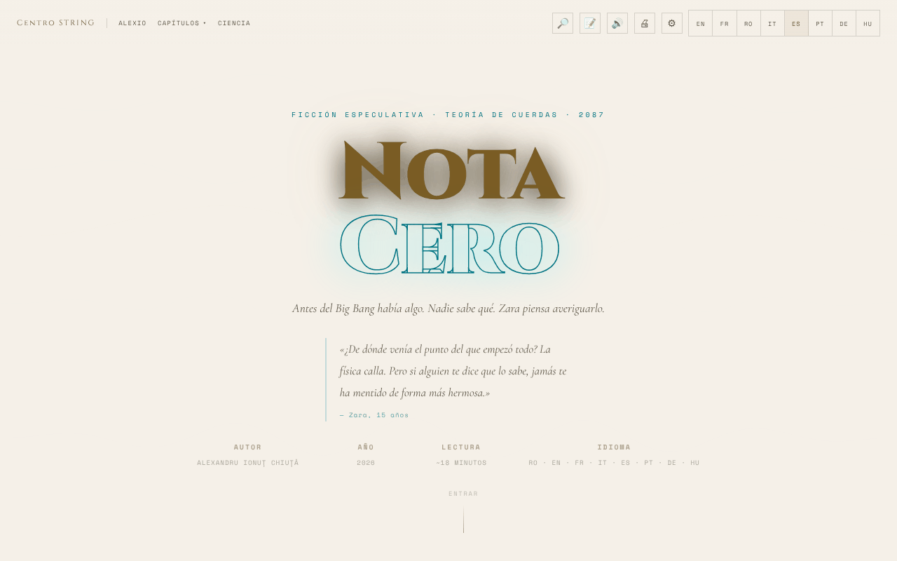

# Nota Zero

[English](README.md) · [Română](README.ro.md) · [Français](README.fr.md) · [Italiano](README.it.md) · **Español** · [Português](README.pt.md) · [Deutsch](README.de.md) · [Magyar](README.hu.md)

**Versión:** 1.3.2 · **Última actualización:** 2026-10-19

Idiomas de la interfaz: **Română, English, Français, Italiano, Español, Português (PT), Deutsch, Magyar**

**Ficción / especulación.** Obra literaria; las notas científicas tienen finalidad explicativa y no sustituyen las fuentes académicas.

Relato de ficción especulativa sobre la teoría de cuerdas, legible en rumano, inglés y francés, con lector de voz y opciones de accesibilidad.

**En línea:** https://chiuta.github.io/Nota-Zero/

## Qué es

Nota Zero es un relato de Alexandru Ionuț Chiuță (2026), presentado como una página de lectura de un solo archivo (`index.html`). Según la página, es «ficción especulativa · teoría de cuerdas · 2087», con una lectura de unos 18 minutos, en tres idiomas (RO · EN · FR). Comienza así: «Antes del Big Bang había algo. Nadie sabe qué. Zara tiene intención de averiguarlo.» El texto íntegro está incluido en el archivo, junto con notas científicas.

## Funciones

- Interfaz en 8 idiomas (RO, EN, FR, IT, ES, PT, DE, HU); texto completo en rumano, inglés y francés (en los demás idiomas se muestra el texto en inglés); cambio instantáneo entre idiomas.
- Capítulos: I · La Pregunta Equivocada, Interludio · El Padre, II · La Música antes de los Sonidos, III · La Membrana, IV · Antes del Primer Segundo, V · Las Cuerdas, VI · El Espejo del Universo, VII · El Regreso, Epílogo · 17 de mayo de 2087, más la sección «Notas científicas».
- Menú «Capítulos» con navegación directa; botón «↑» para volver arriba; menú móvil.
- Lectura en voz alta (🔊) mediante la síntesis de voz del navegador (Web Speech API): botón ▶ en cada capítulo, reproductor con pausa, parada, salto entre fragmentos, velocidad (1×) y elección de voz.
- Impresión (🖨).
- «Reanudar la lectura»: en una nueva visita, si antes habías leído más allá del primer capítulo, aparece una barra discreta «Te quedaste en …» con los botones Continuar y Cerrar (sigue el idioma elegido).
- Panel de accesibilidad (⚙): tamaño del texto (A− / A+), fuente para dislexia (Atkinson Hyperlegible), espaciado de letras/palabras/líneas/párrafos, sombra del texto, columna estrecha, subrayado de enlaces, contraste alto, modo claro, modo sepia (fondo beige claro con texto marrón), sin animaciones, guía de lectura, modos para daltonismo (protanopía, deuteranopía, tritanopía) y «Restablecer todas las preferencias».
- Animación de fondo (canvas) en la cabecera, que se puede desactivar desde «Sin animaciones».

## Otros archivos

- `index.md` — el texto del relato en formato Markdown (versión en rumano).
- `recenzie.html` — una «Reseña exhaustiva» de la obra, **generada por un modelo de IA (Claude Sonnet 4.6)**, no crítica literaria independiente; las puntuaciones (p. ej. 9,4/10) se generan automáticamente y no fueron validadas por un evaluador humano. La etiqueta «Recenzie generată de AI / AI-generated review» se muestra en forma bilingüe (RO/EN) en el título, en la cabecera, en la nota y en el pie.

## La serie completa (41 volúmenes)

Además del relato de `index.html` (volumen I), el repositorio contiene la serie *Nota Zero* en rumano:

- `serie/` — la edición final (19 archivos, 41 volúmenes), con `index.html` como índice. Empieza en `serie/index.html`.
- `serie/arhiva-initiala/` — la serie inicial, con los volúmenes por temas, y los 10 análisis críticos (generados por un modelo de IA).
- `serie/suplimentare/` — *Nota Muzicii* (Vol. XVII-A), diez escenas en prosa, una reseña ficticia del año 2400 y la guía de implementación.
- `serie/COMPARATIE.md` — la comparación entre la edición final y la serie completa y lo que se fusionó.
- `carte/Nota-Zero-carte-completa-ro.pdf` — el libro completo, 478 páginas, formato A5; `carte/Nota-Zero-carte-completa-ro.md` — todo el texto del PDF, en Markdown.

Las páginas de `serie/` son estáticas, con solo pequeños scripts locales (animaciones de fondo, barra de progreso), sin llamadas de red, con una excepción: dos análisis del archivo (`ANALIZA-clasamente-72-indicatori.html`, `ANALIZA-recenzie-titlologica.html`) cargan Chart.js desde cdnjs.cloudflare.com para los gráficos (el texto se lee también sin él). Ninguna página carga fuentes externas. Los textos son ficción escrita en colaboración con Claude (Anthropic); las reseñas y clasificaciones las genera un modelo de IA y no son crítica independiente.

## Manual de uso

1. Abre la página y elige el idioma con los botones **RO / EN / FR / IT / ES / PT / DE / HU** de la barra superior (o desde el menú ☰ en móvil).
2. Lee desplazándote, o salta a un capítulo desde el menú «Capítulos»; «Ciencia» lleva a las «Notas científicas».
3. Para escuchar: pulsa 🔊 en la barra o ▶ junto al título de un capítulo. Con la reproducción activa, **Espacio** pausa/reanuda y **Esc** detiene.
4. Desde ⚙ Accesibilidad ajustas el tamaño del texto, la fuente, el espaciado, el contraste, los modos de color y más; las preferencias se guardan automáticamente.
5. Usa 🖨 para imprimir el texto.
6. En los menús desplegables, las flechas ↑ / ↓ mueven la selección, Esc cierra, Tab cierra el menú.

## Privacidad y red

- **Almacenamiento local (localStorage):** el idioma (`nz-lang`), el tamaño del texto (`nz-fz`), las preferencias de accesibilidad (`nz-a11y-*`, `nz-cb`), el último capítulo alcanzado (`nz-pos`), la velocidad y la voz de lectura (`nz-tts-speed`, `nz-tts-voice-*`). No se almacenan el texto ni otros datos personales.
- **Red:** no he encontrado llamadas `fetch`/XHR ni scripts o fuentes cargados desde servidores externos. Los enlaces a centrulstring.ro, alexio.tf, Buy Me a Coffee y chiuta.github.io se abren solo al hacer clic.
- La lectura en voz alta usa las voces instaladas en el navegador/sistema; algunos navegadores pueden enviar el texto a un servicio de voz propio, según la voz elegida (comportamiento del navegador, no de la aplicación).

## Ejecución local / sin conexión

Descarga `index.html` y ábrelo en un navegador; el texto, la accesibilidad y la impresión no necesitan Internet. El lector de voz depende de las voces disponibles localmente en el navegador/sistema.

## Licencia

MIT — véase el archivo LICENSE

## Auditoría

Auditoría: 2026-10-10 (actualizada el 2026-10-11) — sin `fetch`/XHR/CDN; la única salida a la red es al hacer clic en enlaces. Correcciones de accesibilidad (etiquetas para los interruptores del panel de accesibilidad, contraste en los temas claros, paneles con fondo oscuro en modo claro).

## Funciones nuevas (v1.1.0)

- **Búsqueda local en el texto** (botón 🔎, FFF.search): busca en los párrafos de los capítulos del idioma activo (ro, en, fr), sin distinguir signos diacríticos y con pequeños errores, y luego salta al pasaje. Sin red.
- **Marcadores y notas** (botón 📝): seleccionas un fragmento, añades una nota; se conservan solo en el navegador, se pueden borrar, exportar como Markdown y entran en la copia de seguridad .fff.json (desde «Transparencia»).
- La lectura en voz alta de los capítulos, ya existente, no cambia; kit común (core, label, bundle, tts, search).
- Los textos nuevos están en todos los idiomas de la aplicación (incluidos hu/de donde existe un sistema i18n); las traducciones automáticas no están verificadas por hablantes nativos.
- Pruebas: `tests/fff-r8.test.mjs` (red bloqueada, 1280 y 360 px, axe 0 infracciones con los diálogos abiertos, notas añadidas/conservadas/borradas/exportadas).

## Historial / Changelog

- **19 de octubre de 2026 (versión 1.2.0):** en las «Notas científicas», enlaces a Horizons (Universo cíclico, Fondo cósmico de microondas) y a Universul-Observabil-3D; textos ro/en/fr.

- **18 de octubre de 2026:** añadidas la serie completa (`serie/`), el archivo inicial, los materiales suplementarios y el PDF del libro; en la edición final, los libros II–V tienen el texto íntegro en lugar de los resúmenes (véase `serie/COMPARATIE.md`). La aplicación de `index.html` no cambió.

- **18 de octubre de 2026:** enlaces profundos `?cap=1…7`, `?cap=epilog` y `?cap=science` (equivalentes a `#capN`; el hash tiene prioridad; los valores no válidos se ignoran). Sección «Puentes hacia otras aplicaciones» en `serie/` y archivos de importación en `punti/`. CSP: hash recalculado.
- **18 de octubre de 2026 (versión 1.1.1):** `?cap=1b` (Interludio) y foco en el capítulo de destino con `?cap=`; etiquetas honestas para los puentes TerRa/ORARIUM de `serie/` (lugar y hora ilustrativos, tiempo orbital), la Tierra «alta en el cielo lunar» (≈31° de elevación) en el Vol. I, la nota de archivo, el enlace puentes → GitHub; archivos de importación corregidos (BorderlessMelodies, Akasha, CalmWaves ≤ 8 preajustes).
- **14 de octubre de 2026 (versión 1.1.0):** búsqueda local en el texto, marcadores y notas exportables, kit común, pruebas.

- **12 de octubre de 2026 (versión 1.0.0):** 1.0.0 — 2026-10-12: la versión y la fecha de la última actualización se muestran en la aplicación (pie, traducida RO/EN/FR).

- **11 de octubre de 2026 (rev. 3):** la atribución de la cita de la cabecera ya no toca la fila AUTOR/AÑO en escritorio (margen bajo la cita); la barra de progreso expone también el tiempo restante estimado (`aria-valuetext`, ~18 min en total, RO/EN/FR) y ya no produce NaN en páginas sin desplazamiento. CSP: hash recalculado.
- **11 de octubre de 2026 (rev. 2):** los 82 manejadores `onclick`/`onchange` en línea se sustituyeron por un despachador delegado (`data-onclick`/`data-onchange`, argumentos literales, lista blanca de funciones); la CSP tiene ahora `script-src` con hash y sin `'unsafe-inline'`. El tamaño del texto (A−/A+) se aplicaba solo parcialmente en los párrafos de los capítulos a ≥1100 px y en móvil; ahora escala en todas partes. Activar una opción (p. ej. dislexia) ya no cambia el tema de claro (del sistema) a oscuro. Novedad: «Reanudar la lectura».
- **11 de octubre de 2026:** el modo sepia daba un fondo oscuro (rgb(26,20,16)); ahora es un tema claro cálido (fondo #f4e8d0, texto marrón #3b2a14). La barra de progreso y los botones de apoyo están ahora en puntos de referencia ARIA (`complementary`), de modo que axe-core informa de 0 infracciones (regla `region`) a 1280 y 360 px. Sin cambios: 82 manejadores `onclick` en línea (la CSP mantiene `'unsafe-inline'`). La sección «Lo que sigue siendo desconocido · Mayo de 2026» conserva su fecha; no he encontrado una nueva confirmación experimental de la teoría de cuerdas, del gravitón o de las dimensiones extra en esta fecha.

## Autor

Alexio — Alexandru-Ionuț Chiuță, contacto: alexio@trom.tf. La página remite al Centrul STRING (centrulstring.ro).

## Resumen

Nota Zero es un relato de ficción especulativa sobre la teoría de cuerdas de Alexandru Ionuț Chiuță, presentado como una página de lectura de un solo archivo en rumano, inglés y francés (unos 18 minutos). Ofrece navegación por capítulos, notas científicas, lectura en voz alta con la síntesis de voz del navegador, impresión y un amplio panel de accesibilidad (fuente para dislexia, espaciado, contraste, sepia, modos para daltonismo). Las preferencias se guardan en localStorage; sin solicitudes de red. Licencia MIT.
