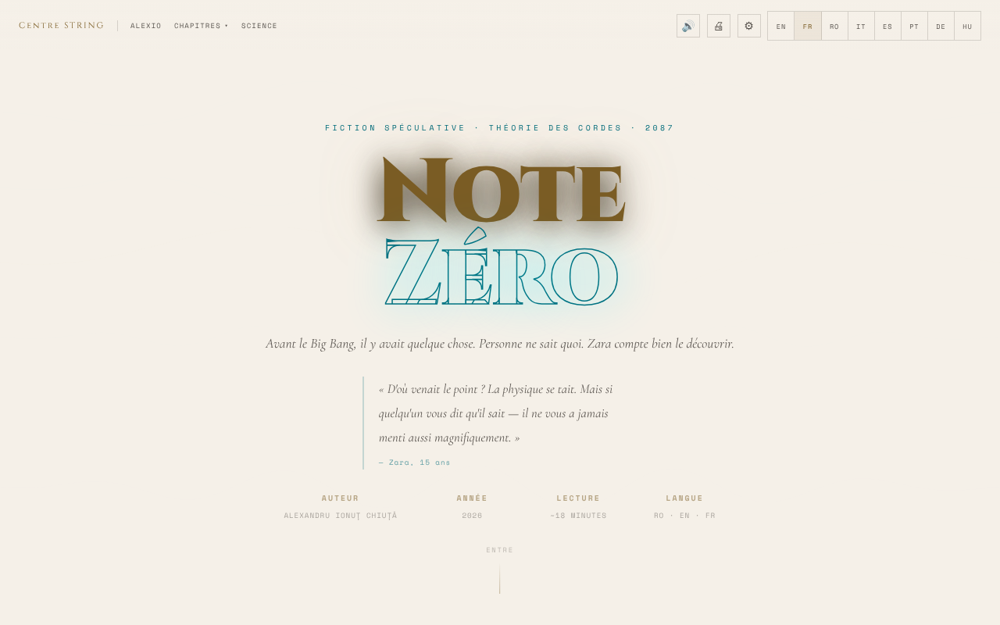

# Nota Zero

[English](README.md) · [Română](README.ro.md) · **Français** · [Italiano](README.it.md) · [Español](README.es.md) · [Português](README.pt.md) · [Deutsch](README.de.md) · [Magyar](README.hu.md)

**Version :** 1.3.0 · **Dernière mise à jour :** 2026-10-19

Langues de l'interface : **Română, English, Français, Italiano, Español, Português (PT), Deutsch, Magyar**

**Fiction / spéculation.** Œuvre littéraire ; les notes scientifiques ont une visée explicative et ne remplacent pas les sources académiques.

Nouvelle de fiction spéculative sur la théorie des cordes, lisible en roumain, anglais et français, avec lecteur vocal et options d'accessibilité.

**En ligne :** https://chiuta.github.io/Nota-Zero/

## Ce que c'est

Nota Zero est une nouvelle d'Alexandru Ionuț Chiuță (2026), présentée comme une page de lecture en un seul fichier (`index.html`). Selon la page, c'est de la « fiction spéculative · théorie des cordes · 2087 », avec une lecture d'environ 18 minutes, en trois langues (RO · EN · FR). Elle commence ainsi : « Avant le Big Bang, il y avait quelque chose. Personne ne sait quoi. Zara compte le découvrir. » Le texte intégral est inclus dans le fichier, avec des notes scientifiques.

## Fonctions

- Interface en 8 langues (RO, EN, FR, IT, ES, PT, DE, HU) ; texte complet en roumain, anglais et français (dans les autres langues, le texte anglais s'affiche) ; bascule instantanée entre les langues.
- Chapitres : I · La Mauvaise Question, Interlude · Le Père, II · La Musique avant les sons, III · La Membrane, IV · Avant la première seconde, V · Les Cordes, VI · Le Miroir de l'Univers, VII · Le Retour, Épilogue · 17 mai 2087, plus la section « Notes scientifiques ».
- Menu « Chapitres » avec navigation directe ; bouton « ↑ » pour revenir en haut ; menu mobile.
- Lecture à voix haute (🔊) via la synthèse vocale du navigateur (Web Speech API) : bouton ▶ à chaque chapitre, lecteur avec pause, arrêt, saut entre les passages, vitesse (1×) et choix de la voix.
- Impression (🖨).
- « Reprendre la lecture » : lors d'une nouvelle visite, si vous aviez lu au-delà du premier chapitre, une barre discrète « Vous en étiez à … » apparaît avec les boutons Continuer et Fermer (elle suit la langue choisie).
- Panneau d'accessibilité (⚙) : taille du texte (A− / A+), police pour la dyslexie (Atkinson Hyperlegible), espacement des lettres/mots/lignes/paragraphes, ombre du texte, colonne étroite, soulignement des liens, contraste élevé, mode clair, mode sépia (fond beige clair avec texte brun), sans animations, guide de lecture, modes pour le daltonisme (protanopie, deutéranopie, tritanopie) et « Réinitialiser toutes les préférences ».
- Animation d'arrière-plan (canvas) dans l'en-tête, désactivable via « Sans animations ».

## Autres fichiers

- `index.md` — le texte de la nouvelle au format Markdown (version roumaine).
- `recenzie.html` — une « Critique exhaustive » de l'œuvre, **générée par un modèle d'IA (Claude Sonnet 4.6)**, et non une critique littéraire indépendante ; les notes (par ex. 9,4/10) sont générées automatiquement et n'ont pas été validées par un évaluateur humain. L'étiquette « Recenzie generată de AI / AI-generated review » est affichée en version bilingue (RO/EN) dans le titre, dans l'en-tête, dans la note et dans le pied de page.

## La série complète (41 volumes)

Outre la nouvelle de `index.html` (volume I), le dépôt contient la série *Nota Zero* en roumain :

- `serie/` — l'édition finale (19 fichiers, 41 volumes), avec `index.html` comme table des matières. Elle commence à `serie/index.html`.
- `serie/arhiva-initiala/` — la série initiale, avec les volumes par thème, et les 10 analyses critiques (générées par un modèle d'IA).
- `serie/suplimentare/` — *Nota Muzicii* (Vol. XVII-A), dix scènes en prose, une critique fictive de l'an 2400 et le guide de mise en œuvre.
- `serie/COMPARATIE.md` — la comparaison entre l'édition finale et la série complète, et ce qui a été fusionné.
- `carte/Nota-Zero-carte-completa-ro.pdf` — le livre complet, 478 pages, format A5 ; `carte/Nota-Zero-carte-completa-ro.md` — tout le texte du PDF, en Markdown.

Les pages de `serie/` sont statiques, avec seulement de petits scripts locaux (animations d'arrière-plan, barre de progression), sans appels réseau, à une exception près : deux analyses de l'archive (`ANALIZA-clasamente-72-indicatori.html`, `ANALIZA-recenzie-titlologica.html`) chargent Chart.js depuis cdnjs.cloudflare.com pour les graphiques (le texte se lit aussi sans). Aucune page ne charge de polices externes. Les textes sont de la fiction écrite en collaboration avec Claude (Anthropic) ; les critiques et classements sont générés par un modèle d'IA et ne constituent pas une critique indépendante.

## Mode d'emploi

1. Ouvrez la page et choisissez la langue avec les boutons **RO / EN / FR / IT / ES / PT / DE / HU** de la barre supérieure (ou depuis le menu ☰ sur mobile).
2. Lisez en faisant défiler, ou passez à un chapitre depuis le menu « Chapitres » ; « Science » mène aux « Notes scientifiques ».
3. Pour écouter : appuyez sur 🔊 dans la barre ou sur ▶ à côté du titre d'un chapitre. Pendant la lecture, **Espace** met en pause/reprend et **Échap** arrête.
4. Depuis ⚙ Accessibilité, vous réglez la taille du texte, la police, l'espacement, le contraste, les modes de couleur et plus encore ; les préférences sont enregistrées automatiquement.
5. Utilisez 🖨 pour imprimer le texte.
6. Dans les menus déroulants, les flèches ↑ / ↓ déplacent la sélection, Échap ferme, Tab ferme le menu.

## Confidentialité et réseau

- **Stockage local (localStorage) :** la langue (`nz-lang`), la taille du texte (`nz-fz`), les préférences d'accessibilité (`nz-a11y-*`, `nz-cb`), le dernier chapitre atteint (`nz-pos`), la vitesse et la voix de lecture (`nz-tts-speed`, `nz-tts-voice-*`). Le texte et d'autres données personnelles ne sont pas stockés.
- **Réseau :** je n'ai trouvé aucun appel `fetch`/XHR ni script ou police chargés depuis des serveurs externes. Les liens vers centrulstring.ro, alexio.tf, Buy Me a Coffee et chiuta.github.io ne s'ouvrent qu'au clic.
- La lecture à voix haute utilise les voix installées dans le navigateur/le système ; certains navigateurs peuvent envoyer le texte à un service vocal propre, selon la voix choisie (comportement du navigateur, non de l'application).

## Exécution locale / hors ligne

Téléchargez `index.html` et ouvrez-le dans un navigateur ; le texte, l'accessibilité et l'impression n'ont pas besoin d'Internet. Le lecteur vocal dépend des voix disponibles localement dans le navigateur/le système.

## Licence

MIT — voir le fichier LICENSE

## Audit

Audit : 2026-10-10 (mis à jour le 2026-10-11) — sans `fetch`/XHR/CDN ; la seule sortie vers le réseau a lieu au clic sur des liens. Corrections d'accessibilité (étiquettes pour les commutateurs du panneau d'accessibilité, contraste dans les thèmes clairs, panneaux à fond sombre en mode clair).

## Nouvelles fonctions (v1.1.0)

- **Recherche locale dans le texte** (bouton 🔎, FFF.search) : cherche dans les paragraphes des chapitres de la langue active (ro, en, fr), sans tenir compte des diacritiques et avec de petites fautes, puis saute au passage. Sans réseau.
- **Signets et notes** (bouton 📝) : vous sélectionnez un passage, ajoutez une note ; ils ne sont conservés que dans le navigateur, peuvent être supprimés, exportés en Markdown et sont inclus dans la sauvegarde .fff.json (depuis « Transparence »).
- La lecture à voix haute des chapitres, déjà existante, reste inchangée ; kit commun (core, label, bundle, tts, search).
- Les nouveaux textes existent dans toutes les langues de l'application (y compris hu/de là où un système i18n existe) ; les traductions automatiques ne sont pas vérifiées par des locuteurs natifs.
- Tests : `tests/fff-r8.test.mjs` (réseau bloqué, 1280 et 360 px, axe 0 violation avec les boîtes de dialogue ouvertes, notes ajoutées/conservées/supprimées/exportées).

## Historique / Changelog

- **19 octobre 2026 (version 1.2.0) :** dans les « Notes scientifiques », liens vers Horizons (Univers cyclique, Fond diffus cosmologique) et Universul-Observabil-3D ; textes ro/en/fr.

- **18 octobre 2026 :** ajout de la série complète (`serie/`), de l'archive initiale, des matériels supplémentaires et du PDF du livre ; dans l'édition finale, les livres II–V ont le texte intégral à la place des résumés (voir `serie/COMPARATIE.md`). L'application de `index.html` n'a pas changé.

- **18 octobre 2026 :** liens profonds `?cap=1…7`, `?cap=epilog` et `?cap=science` (équivalents à `#capN` ; le hachage a la priorité ; les valeurs invalides sont ignorées). Section « Passerelles vers d'autres applications » dans `serie/` et fichiers d'import dans `punti/`. CSP : hachage recalculé.
- **18 octobre 2026 (version 1.1.1) :** `?cap=1b` (Interlude) et focus sur le chapitre cible avec `?cap=` ; étiquettes honnêtes pour les passerelles TerRa/ORARIUM de `serie/` (lieu et heure illustratifs, temps orbital), la Terre « haut dans le ciel lunaire » (≈31° d'élévation) dans le Vol. I, la note d'archive, le lien passerelles → GitHub ; fichiers d'import corrigés (BorderlessMelodies, Akasha, CalmWaves ≤ 8 préréglages).
- **14 octobre 2026 (version 1.1.0) :** recherche locale dans le texte, signets et notes exportables, kit commun, tests.

- **12 octobre 2026 (version 1.0.0) :** 1.0.0 — 2026-10-12 : la version et la date de la dernière mise à jour sont affichées dans l'application (pied de page, traduite RO/EN/FR).

- **11 octobre 2026 (rév. 3) :** l'attribution de la citation de l'en-tête ne touche plus la ligne AUTEUR/ANNÉE sur ordinateur (marge sous la citation) ; la barre de progression expose aussi le temps restant estimé (`aria-valuetext`, ~18 min au total, RO/EN/FR) et ne produit plus de NaN sur les pages sans défilement. CSP : hachage recalculé.
- **11 octobre 2026 (rév. 2) :** les 82 gestionnaires `onclick`/`onchange` en ligne ont été remplacés par un répartiteur délégué (`data-onclick`/`data-onchange`, arguments littéraux, liste blanche de fonctions) ; la CSP a désormais `script-src` avec hachage et sans `'unsafe-inline'`. La taille du texte (A−/A+) ne s'appliquait que partiellement aux paragraphes des chapitres à ≥1100 px et sur mobile ; elle s'applique maintenant partout. L'activation d'une option (par ex. dyslexie) ne fait plus passer le thème du clair (du système) au sombre. Nouveau : « Reprendre la lecture ».
- **11 octobre 2026 :** le mode sépia donnait un fond sombre (rgb(26,20,16)) ; c'est désormais un thème clair chaleureux (fond #f4e8d0, texte brun #3b2a14). La barre de progression et les boutons de soutien sont désormais dans des repères ARIA (`complementary`), si bien qu'axe-core ne signale aucune violation (règle `region`) à 1280 et 360 px. Inchangé : 82 gestionnaires `onclick` en ligne (la CSP conserve `'unsafe-inline'`). La section « Ce qui reste inconnu · Mai 2026 » conserve sa date ; je n'ai trouvé aucune nouvelle confirmation expérimentale de la théorie des cordes, du graviton ou des dimensions supplémentaires à cette date.

## Auteur

Alexio — Alexandru-Ionuț Chiuță, contact : alexio@trom.tf. La page renvoie vers le Centrul STRING (centrulstring.ro).

## Résumé en anglais

Nota Zero est une nouvelle de fiction spéculative sur la théorie des cordes d'Alexandru Ionuț Chiuță, présentée comme une page de lecture en un seul fichier en roumain, anglais et français (environ 18 minutes). Elle propose une navigation par chapitres, des notes scientifiques, une lecture à voix haute par synthèse vocale du navigateur, l'impression et un vaste panneau d'accessibilité (police pour la dyslexie, espacement, contraste, sépia, modes pour daltoniens). Les préférences sont conservées dans localStorage ; aucune requête réseau. Licence MIT.
