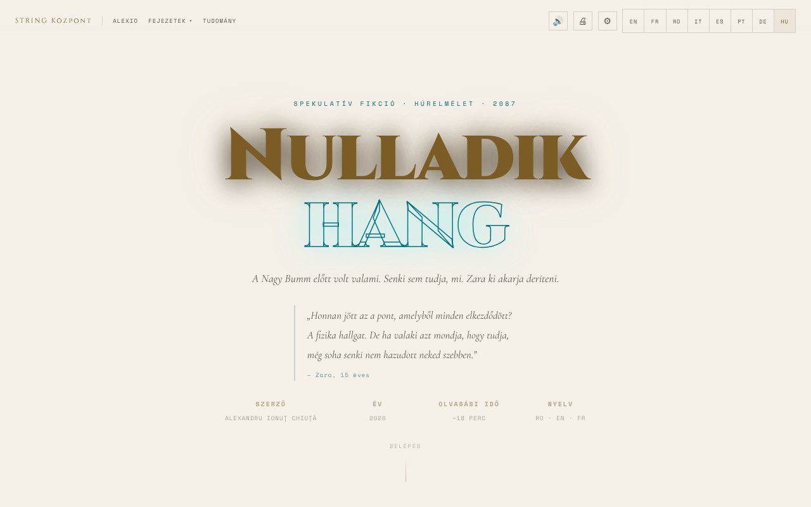

# Nota Zero

[English](README.md) · [Română](README.ro.md) · [Français](README.fr.md) · [Italiano](README.it.md) · [Español](README.es.md) · [Português](README.pt.md) · [Deutsch](README.de.md) · **Magyar**

**Verzió:** 1.3.0 · **Utolsó frissítés:** 2026-10-19

A felület nyelvei: **Română, English, Français, Italiano, Español, Português (PT), Deutsch, Magyar**

**Fikció / spekuláció.** Irodalmi mű; a tudományos jegyzetek magyarázó célúak, és nem helyettesítik a tudományos forrásokat.

Spekulatív fikciós novella a húrelméletről, románul, angolul és franciául olvasható, felolvasóval és akadálymentességi lehetőségekkel.

**Élő:** https://chiuta.github.io/Nota-Zero/

## Mi ez

A Nota Zero Alexandru Ionuț Chiuță novellája (2026), egyetlen fájlos olvasóoldalként bemutatva (`index.html`). Az oldal szerint „spekulatív fikció · húrelmélet · 2087”, kb. 18 perces olvasással, három nyelven (RO · EN · FR). Így kezdődik: „A Big Bang előtt volt valami. Senki sem tudja, mi. Zara ki akarja deríteni.” A teljes szöveg a fájlban van, tudományos jegyzetekkel együtt.

## Funkciók

- 8 nyelvű felület (RO, EN, FR, IT, ES, PT, DE, HU); teljes szöveg románul, angolul és franciául (a többi nyelven az angol szöveg látható); azonnali váltás a nyelvek között.
- Fejezetek: I · A rossz kérdés, Közjáték · Az apa, II · A hangok előtti zene, III · A membrán, IV · Az első másodperc előtt, V · A húrok, VI · A világegyetem tükre, VII · A visszatérés, Epilógus · 2087. május 17., valamint a „Tudományos jegyzetek” szakasz.
- „Fejezetek” menü közvetlen navigációval; „↑” gomb a tetejére való visszatéréshez; mobilmenü.
- Felolvasás (🔊) a böngésző beszédszintézisével (Web Speech API): ▶ gomb minden fejezetnél, lejátszó szünettel, leállítással, ugrással a szakaszok között, sebességgel (1×) és hangválasztással.
- Nyomtatás (🖨).
- „Olvasás folytatása”: újabb látogatáskor, ha korábban az első fejezeten túl olvastál, egy diszkrét sáv jelenik meg: „Itt tartottál …” Folytatás és Bezárás gombokkal (követi a kiválasztott nyelvet).
- Akadálymentességi panel (⚙): szövegméret (A− / A+), diszlexiás betűtípus (Atkinson Hyperlegible), betű-/szó-/sor-/bekezdéstávolság, szövegárnyék, keskeny oszlop, hivatkozások aláhúzása, magas kontraszt, világos mód, szépia mód (világos bézs háttér barna szöveggel), animációk nélkül, olvasási segéd, színtévesztő módok (protanópia, deuteranópia, tritanópia) és „Minden beállítás visszaállítása”.
- Háttéranimáció (canvas) a fejlécben, amely az „Animációk nélkül” opcióval kikapcsolható.

## További fájlok

- `index.md` — a novella szövege Markdown formátumban (román változat).
- `recenzie.html` — a mű „Kimerítő recenziója”, amelyet **egy MI-modell (Claude Sonnet 4.6) generált**, nem független irodalomkritika; a pontszámok (pl. 9,4/10) automatikusan generáltak, és emberi értékelő nem hagyta jóvá őket. A „Recenzie generată de AI / AI-generated review” felirat kétnyelvűen (RO/EN) látható a címben, a fejlécben, a megjegyzésben és a láblécben.

## A teljes sorozat (41 kötet)

Az `index.html` novelláján (I. kötet) túl a tároló tartalmazza a *Nota Zero* sorozatot románul:

- `serie/` — a végleges kiadás (19 fájl, 41 kötet), az `index.html` tartalomjegyzékként. A `serie/index.html` oldalon kezdődik.
- `serie/arhiva-initiala/` — a kezdeti sorozat, a kötetekkel téma szerint, és a 10 kritikai elemzés (MI-modell által generálva).
- `serie/suplimentare/` — *Nota Muzicii* (XVII-A. kötet), tíz prózai jelenet, egy fiktív recenzió a 2400-as évből és a megvalósítási útmutató.
- `serie/COMPARATIE.md` — a végleges kiadás és a teljes sorozat összehasonlítása, és hogy mi lett összeolvasztva.
- `carte/Nota-Zero-carte-completa-ro.pdf` — a teljes könyv, 478 oldal, A5 formátum; `carte/Nota-Zero-carte-completa-ro.md` — a PDF teljes szövege Markdownban.

A `serie/` oldalai statikusak, csak kis helyi szkriptekkel (háttéranimációk, folyamatjelző sáv), hálózati hívások nélkül, egy kivétellel: az archívum két elemzése (`ANALIZA-clasamente-72-indicatori.html`, `ANALIZA-recenzie-titlologica.html`) a cdnjs.cloudflare.com-ról tölti be a Chart.js-t a grafikonokhoz (a szöveg enélkül is olvasható). Egyetlen oldal sem tölt be külső betűtípusokat. A szövegek a Claude-dal (Anthropic) együttműködésben írt fikció; a recenziókat és a rangsorokat MI-modell generálja, és nem független kritika.

## Használati útmutató

1. Nyisd meg az oldalt, és válaszd ki a nyelvet a felső sáv **RO / EN / FR / IT / ES / PT / DE / HU** gombjaival (vagy mobilon a ☰ menüből).
2. Olvass görgetéssel, vagy ugorj egy fejezetre a „Fejezetek” menüből; a „Tudomány” a „Tudományos jegyzetekhez” visz.
3. Hallgatáshoz: nyomd meg a 🔊 gombot a sávban vagy a ▶ gombot egy fejezet címe mellett. Lejátszás közben a **szóköz** szünetel/folytat, az **Esc** leállít.
4. A ⚙ Akadálymentesség alatt beállítod a szövegméretet, a betűtípust, a térközöket, a kontrasztot, a színmódokat és egyebeket; a beállítások automatikusan mentődnek.
5. A 🖨 gombbal kinyomtathatod a szöveget.
6. A legördülő menükben a ↑ / ↓ nyilak mozgatják a kijelölést, az Esc bezár, a Tab bezárja a menüt.

## Adatvédelem és hálózat

- **Helyi tárhely (localStorage):** a nyelv (`nz-lang`), a szövegméret (`nz-fz`), az akadálymentességi beállítások (`nz-a11y-*`, `nz-cb`), az utoljára elért fejezet (`nz-pos`), a felolvasás sebessége és hangja (`nz-tts-speed`, `nz-tts-voice-*`). A szöveget és más személyes adatokat nem tárolja.
- **Hálózat:** nem találtam `fetch`/XHR hívásokat, sem külső szerverekről betöltött szkripteket vagy betűtípusokat. A centrulstring.ro, alexio.tf, Buy Me a Coffee és chiuta.github.io hivatkozások csak kattintásra nyílnak meg.
- A felolvasás a böngészőben/rendszerben telepített hangokat használja; egyes böngészők a kiválasztott hangtól függően elküldhetik a szöveget saját beszédszolgáltatásuknak (a böngésző viselkedése, nem az alkalmazásé).

## Helyi / offline futtatás

Töltsd le az `index.html` fájlt, és nyisd meg böngészőben; a szöveghez, az akadálymentességhez és a nyomtatáshoz nincs szükség internetre. A felolvasó a böngészőben/rendszerben helyben elérhető hangoktól függ.

## Licenc

MIT — lásd a LICENSE fájlt

## Audit

Audit: 2026-10-10 (frissítve 2026-10-11) — `fetch`/XHR/CDN nélkül; az egyetlen hálózati kimenet a hivatkozásokra kattintáskor történik. Akadálymentességi javítások (címkék az akadálymentességi panel kapcsolóihoz, kontraszt a világos témákban, sötét hátterű panelek világos módban).

## Új funkciók (v1.1.0)

- **Helyi keresés a szövegben** (🔎 gomb, FFF.search): az aktív nyelv (ro, en, fr) fejezetbekezdéseiben keres, ékezetek nélkül és kisebb elírásokkal, majd a szakaszra ugrik. Hálózat nélkül.
- **Könyvjelzők és jegyzetek** (📝 gomb): kijelölsz egy részletet, jegyzetet fűzöl hozzá; csak a böngészőben maradnak meg, törölhetők, Markdownként exportálhatók, és bekerülnek a .fff.json biztonsági mentésbe (az „Átláthatóság” menüpontból).
- A fejezetek már meglévő felolvasása változatlan marad; közös készlet (core, label, bundle, tts, search).
- Az új szövegek az alkalmazás minden nyelvén megvannak (beleértve a hu/de nyelvet, ahol van i18n rendszer); az automatikus fordításokat anyanyelvi beszélők nem ellenőrizték.
- Tesztek: `tests/fff-r8.test.mjs` (blokkolt hálózat, 1280 és 360 px, axe 0 hiba megnyitott párbeszédpanelekkel, jegyzetek hozzáadva/megőrizve/törölve/exportálva).

## Előzmények / Changelog

- **2026. október 19. (1.2.0 verzió):** a „Tudományos jegyzetekben” hivatkozások a Horizonsra (Ciklikus világegyetem, Kozmikus mikrohullámú háttérsugárzás) és az Universul-Observabil-3D-re; ro/en/fr szövegek.

- **2026. október 18.:** hozzáadva a teljes sorozat (`serie/`), a kezdeti archívum, a kiegészítő anyagok és a könyv PDF-je; a végleges kiadásban a II–V. könyvek a kivonatok helyett a teljes szöveggel szerepelnek (lásd `serie/COMPARATIE.md`). Az `index.html` alkalmazása nem változott.

- **2026. október 18.:** mélyhivatkozások `?cap=1…7`, `?cap=epilog` és `?cap=science` (egyenértékűek a `#capN`-nel; a hash élvez elsőbbséget; az érvénytelen értékeket figyelmen kívül hagyja). „Hidak más alkalmazásokhoz” szakasz a `serie/`-ben és importfájlok a `punti/`-ban. CSP: hash újraszámolva.
- **2026. október 18. (1.1.1 verzió):** `?cap=1b` (Közjáték) és fókusz a célfejezetre `?cap=` esetén; őszinte címkék a `serie/` TerRa/ORARIUM hídjaihoz (szemléltető hely és idő, pályaidő), a Föld „magasan a holdi égbolton” (≈31° magasság) az I. kötetben, az archívum-megjegyzés, a hidak → GitHub hivatkozás; javított importfájlok (BorderlessMelodies, Akasha, CalmWaves ≤ 8 előbeállítás).
- **2026. október 14. (1.1.0 verzió):** helyi keresés a szövegben, exportálható könyvjelzők és jegyzetek, közös készlet, tesztek.

- **2026. október 12. (1.0.0 verzió):** 1.0.0 — 2026-10-12: a verzió és az utolsó frissítés dátuma megjelenik az alkalmazásban (lábléc, lefordítva RO/EN/FR).

- **2026. október 11. (3. változat):** a fejlécben lévő idézet forrásmegjelölése asztali gépen már nem érinti a SZERZŐ/ÉV sort (margó az idézet alatt); a folyamatjelző sáv a becsült hátralévő időt is megadja (`aria-valuetext`, összesen ~18 perc, RO/EN/FR), és a görgetés nélküli oldalakon már nem ad NaN-t. CSP: hash újraszámolva.
- **2026. október 11. (2. változat):** a 82 inline `onclick`/`onchange` eseménykezelőt egy delegált diszpécser váltotta fel (`data-onclick`/`data-onchange`, literál argumentumok, függvények engedélyezési listája); a CSP-nek most hash-alapú `script-src`-je van, `'unsafe-inline'` nélkül. A szövegméret (A−/A+) ≥1100 px-en és mobilon csak részben érvényesült a fejezetbekezdésekben; most mindenhol skálázódik. Egy opció (pl. diszlexia) bekapcsolása már nem vált át a világos (rendszer szerinti) témáról sötétre. Új: „Olvasás folytatása”.
- **2026. október 11.:** a szépia mód sötét hátteret adott (rgb(26,20,16)); most meleg világos téma (háttér #f4e8d0, barna szöveg #3b2a14). A folyamatjelző sáv és a támogatási gombok mostantól ARIA tájékozódási pontokban (`complementary`) vannak, így az axe-core 0 hibát jelez (a `region` szabály) 1280 és 360 px szélességnél. Változatlan: 82 inline `onclick` eseménykezelő (a CSP megtartja az `'unsafe-inline'`-t). A „Ami ismeretlen marad · 2026. május” szakasz megtartja a dátumát; ezen a napon nem találtam a húrelmélet, a graviton vagy az extra dimenziók újabb kísérleti megerősítését.

## Szerző

Alexio — Alexandru-Ionuț Chiuță, kapcsolat: alexio@trom.tf. Az oldal a Centrul STRING-re (centrulstring.ro) hivatkozik.

## Összefoglaló angolul

A Nota Zero Alexandru Ionuț Chiuță spekulatív fikciós novellája a húrelméletről, egyetlen fájlos olvasóoldalként bemutatva románul, angolul és franciául (kb. 18 perc). Fejezetnavigációt, tudományos jegyzeteket, böngészős beszédszintézissel történő felolvasást, nyomtatást és széles akadálymentességi panelt kínál (diszlexiás betűtípus, térközök, kontraszt, szépia, színtévesztő módok). A beállításokat a localStorage őrzi; hálózati kérések nincsenek. MIT licenc.
