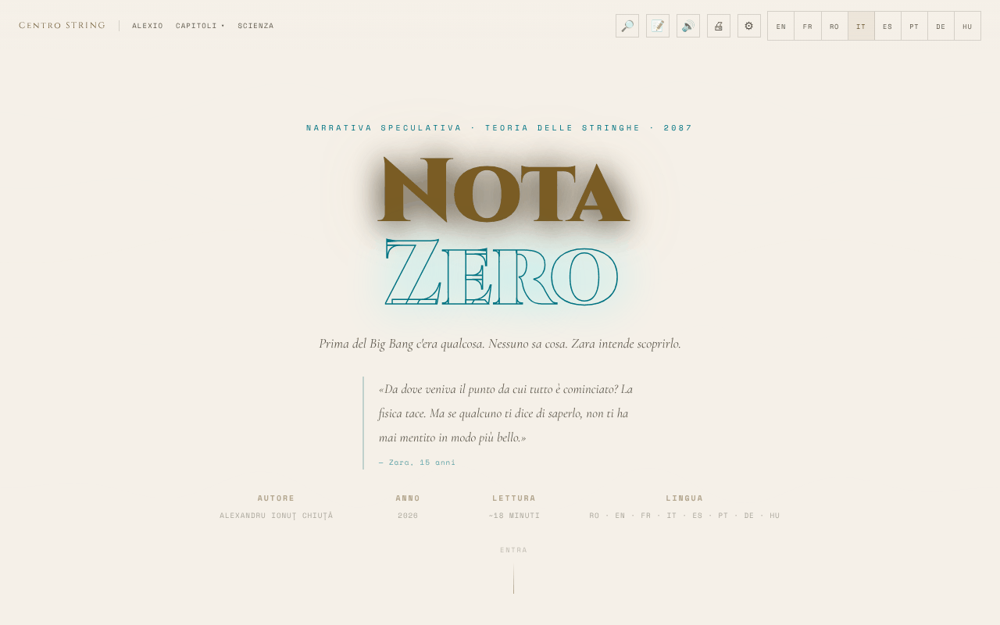

# Nota Zero

[English](README.md) · [Română](README.ro.md) · [Français](README.fr.md) · **Italiano** · [Español](README.es.md) · [Português](README.pt.md) · [Deutsch](README.de.md) · [Magyar](README.hu.md)

**Versione:** 1.4.1 · **Ultimo aggiornamento:** 2026-10-21

Lingue dell'interfaccia: **Română, English, Français, Italiano, Español, Português (PT), Deutsch, Magyar**

**Narrativa / speculazione.** Opera letteraria; le note scientifiche hanno scopo esplicativo e non sostituiscono le fonti accademiche.

Racconto di narrativa speculativa sulla teoria delle stringhe, leggibile in 8 lingue (rumeno, inglese, francese, tedesco, spagnolo, portoghese, italiano, ungherese), con lettore vocale e opzioni di accessibilità.

**Online:** https://chiuta.github.io/Nota-Zero/

## Che cos'è

Nota Zero è un racconto di Alexandru Ionuț Chiuță (2026), presentato come una pagina di lettura in un unico file (`index.html`). Secondo la pagina, è «narrativa speculativa · teoria delle stringhe · 2087», con una lettura di circa 18 minuti, in otto lingue (RO · EN · FR · IT · ES · PT · DE · HU). Inizia così: «Prima del Big Bang c'era qualcosa. Nessuno sa cosa. Zara ha intenzione di scoprirlo.» Il testo integrale è incluso nel file, insieme a note scientifiche.

## Funzioni

- Interfaccia e testo completo in 8 lingue (RO, EN, FR, IT, ES, PT, DE, HU): il racconto (9 capitoli) e le «Note scientifiche» esistono in ogni lingua; le traduzioni in italiano, spagnolo, portoghese, tedesco e ungherese sono state realizzate con l'aiuto dell'IA e non sono state verificate da madrelingua; passaggio istantaneo tra le lingue.
- Capitoli: I · La Domanda Sbagliata, Interludio · Il Padre, II · La Musica prima dei suoni, III · La Membrana, IV · Prima del Primo Secondo, V · Le Stringhe, VI · Lo Specchio dell'Universo, VII · Il Ritorno, Epilogo · 17 maggio 2087, più la sezione «Note scientifiche».
- Menu «Capitoli» con navigazione diretta; pulsante «↑» per tornare in cima; menu mobile.
- Lettura ad alta voce (🔊) tramite la sintesi vocale del browser (Web Speech API): pulsante ▶ a ogni capitolo, lettore con pausa, arresto, salto tra i frammenti, velocità (1×) e scelta della voce.
- Stampa (🖨).
- «Riprendi la lettura»: a una nuova visita, se in precedenza avevi letto oltre il primo capitolo, compare una barra discreta «Eri rimasto a …» con i pulsanti Continua e Chiudi (segue la lingua scelta).
- Pannello di accessibilità (⚙): dimensione del testo (A− / A+), font per la dislessia (Atkinson Hyperlegible), spaziatura di lettere/parole/righe/paragrafi, ombra del testo, colonna stretta, sottolineatura dei link, contrasto elevato, modalità chiara, modalità seppia (sfondo beige chiaro con testo marrone), senza animazioni, guida di lettura, modalità per il daltonismo (protanopia, deuteranopia, tritanopia) e «Reimposta tutte le preferenze».
- Animazione di sfondo (canvas) nell'intestazione, che si può disattivare da «Senza animazioni».

## Altri file

- `index.md` — il testo del racconto in formato Markdown (versione rumena).
- `recenzie.html` — una «Recensione esaustiva» dell'opera, **generata da un modello di IA (Claude Sonnet 4.6)**, non critica letteraria indipendente; i punteggi (ad es. 9,4/10) sono generati automaticamente e non sono stati convalidati da un valutatore umano. L'etichetta «Recenzie generată de AI / AI-generated review» è mostrata in forma bilingue (RO/EN) nel titolo, nell'intestazione, nella nota e nel piè di pagina.
- Limiti linguistici: la recensione (`recenzie.html`) e l'indice della serie (`serie/index.html`) hanno un selettore di lingua (RO/EN/FR/IT/ES/PT/DE/HU; link `?lang=xx`; la scelta è condivisa con l'app tramite `nz-lang`), e la guida all'importazione `punti/README.md` esiste in 8 lingue (l'inglese è canonico). Restano **solo in rumeno**: i 41 volumi (`serie/vol-*.html`, l'apparato critico, i file supplementari e l'archivio iniziale), `carte/` (il libro, PDF), i file di dati in `punti/import/` e `index.md` (il racconto); l'indice della serie lo dichiara nelle altre lingue. Le traduzioni della recensione e della guida all'importazione sono automatiche, non verificate da madrelingua, e richiedono revisione (tono critico, termini di fisica come ekpyrotic/bulk/brane). La recensione descrive l'app v14 (RO/EN/FR) e non è stata aggiornata alle 8 lingue dell'app.

## La serie completa (41 volumi)

Oltre al racconto di `index.html` (volume I), il repository contiene la serie *Nota Zero* in rumeno:

- `serie/` — l'edizione finale (19 file, 41 volumi), con `index.html` come indice. Inizia da `serie/index.html`.
- `serie/arhiva-initiala/` — la serie iniziale, con i volumi per tema, e le 10 analisi critiche (generate da un modello di IA).
- `serie/suplimentare/` — *Nota Muzicii* (Vol. XVII-A), dieci scene in prosa, una recensione fittizia del 2400 e la guida all'implementazione.
- `serie/COMPARATIE.md` — il confronto tra l'edizione finale e la serie completa e ciò che è stato fuso.
- `carte/Nota-Zero-carte-completa-ro.pdf` — il libro completo, 478 pagine, formato A5; `carte/Nota-Zero-carte-completa-ro.md` — tutto il testo del PDF, in Markdown.

Le pagine di `serie/` sono statiche, con soli piccoli script locali (animazioni di sfondo, barra di avanzamento), senza chiamate di rete, con un'eccezione: due analisi dell'archivio (`ANALIZA-clasamente-72-indicatori.html`, `ANALIZA-recenzie-titlologica.html`) caricano Chart.js da cdnjs.cloudflare.com per i grafici (il testo si legge anche senza). Nessuna pagina carica font esterni. I testi sono narrativa scritta in collaborazione con Claude (Anthropic); le recensioni e le classifiche sono generate da un modello di IA e non sono critica indipendente.

## Guida all'uso

1. Apri la pagina e scegli la lingua con i pulsanti **RO / EN / FR / IT / ES / PT / DE / HU** della barra in alto (o dal menu ☰ su dispositivi mobili).
2. Leggi scorrendo, oppure passa a un capitolo dal menu «Capitoli»; «Scienza» porta alle «Note scientifiche».
3. Per ascoltare: premi 🔊 nella barra oppure ▶ accanto al titolo di un capitolo. Con la riproduzione avviata, **Spazio** mette in pausa/riprende e **Esc** interrompe.
4. Da ⚙ Accessibilità imposti la dimensione del testo, il font, la spaziatura, il contrasto, le modalità di colore e altro; le preferenze vengono salvate automaticamente.
5. Usa 🖨 per stampare il testo.
6. Nei menu a discesa, le frecce ↑ / ↓ spostano la selezione, Esc chiude, Tab chiude il menu.

## Privacy e rete

- **Archiviazione locale (localStorage):** la lingua (`nz-lang`), la dimensione del testo (`nz-fz`), le preferenze di accessibilità (`nz-a11y-*`, `nz-cb`), l'ultimo capitolo raggiunto (`nz-pos`), la velocità e la voce della lettura (`nz-tts-speed`, `nz-tts-voice-*`). Il testo e altri dati personali non vengono memorizzati. Fanno eccezione le note che scrivi tu (📝): restano solo nel tuo browser (chiave `fff.nota-zero.notes`), si possono eliminare e vengono esportate solo se lo chiedi.
- **Rete:** non ho trovato chiamate `fetch`/XHR né script o font caricati da server esterni. I link a centrulstring.ro, alexio.tf, Buy Me a Coffee e chiuta.github.io si aprono solo al clic.
- La lettura ad alta voce usa le voci installate nel browser/sistema; alcuni browser possono inviare il testo a un proprio servizio vocale, a seconda della voce scelta (comportamento del browser, non dell'app).

## Esecuzione locale / offline

Scarica `index.html` e aprilo in un browser; il testo, l'accessibilità e la stampa non hanno bisogno di Internet. Il lettore vocale dipende dalle voci disponibili localmente nel browser/sistema.

## Licenza

MIT — vedi il file LICENSE

## Audit

Audit: 2026-10-10 (aggiornato il 2026-10-11) — senza `fetch`/XHR/CDN; l'unica uscita verso la rete avviene al clic sui link. Correzioni di accessibilità (etichette per gli interruttori del pannello di accessibilità, contrasto nei temi chiari, pannelli con sfondo scuro nella modalità chiara).

## Ricerca e note (dalla v1.1.0)

- **Ricerca locale nel testo** (pulsante 🔎, FFF.search): cerca nei paragrafi dei capitoli della lingua attiva (ro, en, fr, it, es, pt, de, hu), senza segni diacritici e con piccoli errori, poi salta al passaggio. Senza rete.
- **Segnalibri e note** (pulsante 📝): selezioni un frammento, aggiungi una nota; vengono conservati solo nel browser, si possono eliminare, esportare come Markdown ed entrano nella copia di riserva .fff.json (da «Trasparenza»).
- La lettura ad alta voce dei capitoli, già presente, resta invariata; kit comune (core, label, bundle, tts, search).
- I nuovi testi sono nelle 8 lingue dell'app (ro, en, fr, it, es, pt, de, hu); le traduzioni automatiche non sono verificate da madrelingua.
- Test: `tests/fff-r8.test.mjs` (rete bloccata, 1280 e 360 px, axe 0 violazioni con i dialoghi aperti, note aggiunte/conservate/eliminate/esportate).

## Cronologia / Changelog

- **21 ottobre 2026 (versione 1.4.1):** `recenzie.html` e `serie/index.html` ricevono un selettore di lingua (8 lingue, `?lang=xx`, chiave comune `nz-lang`) e `punti/README.md` è disponibile in 8 lingue; CSP rigorosa su queste pagine; il link a piè di pagina verso la serie segue la lingua corrente. I 41 volumi restano in rumeno.
- **19 ottobre 2026 (versione 1.4.0):** la ricerca locale e i segnalibri/le note descritti sopra (introdotti nella 1.1.0) sono presenti nella versione attuale: erano stati rimossi per errore in una pulizia precedente e sono stati reimplementati (ricerca in tutte le 8 lingue; note con esportazione Markdown e incluse nella copia `.fff.json`; test in `tests/fff-r8.test.mjs`). Il racconto (9 capitoli), le «Note scientifiche» e l'interfaccia sono disponibili in 8 lingue (italiano, spagnolo, portoghese, tedesco e ungherese aggiunti a rumeno, inglese e francese).

- **19 ottobre 2026 (versione 1.2.0):** nelle «Note scientifiche», link a Horizons (Universo ciclico, Fondo cosmico di microonde) e a Universul-Observabil-3D; testi ro/en/fr.

- **18 ottobre 2026:** aggiunta la serie completa (`serie/`), l'archivio iniziale, i materiali supplementari e il PDF del libro; nell'edizione finale, i libri II–V hanno il testo integrale al posto dei riassunti (vedi `serie/COMPARATIE.md`). L'app in `index.html` non è cambiata.

- **18 ottobre 2026:** link profondi `?cap=1…7`, `?cap=epilog` e `?cap=science` (equivalenti a `#capN`; l'hash ha la priorità; i valori non validi sono ignorati). Sezione «Ponti verso altre app» in `serie/` e file di importazione in `punti/`. CSP: hash ricalcolato.
- **18 ottobre 2026 (versione 1.1.1):** `?cap=1b` (Interludio) e focus sul capitolo di destinazione con `?cap=`; etichette oneste per i ponti TerRa/ORARIUM di `serie/` (luogo e ora illustrativi, tempo orbitale), la Terra «alta nel cielo lunare» (≈31° di elevazione) nel Vol. I, la nota d'archivio, il link ponti → GitHub; file di importazione corretti (BorderlessMelodies, Akasha, CalmWaves ≤ 8 preset).
- **14 ottobre 2026 (versione 1.1.0):** ricerca locale nel testo, segnalibri e note esportabili, kit comune, test.

- **12 ottobre 2026 (versione 1.0.0):** 1.0.0 — 2026-10-12: la versione e la data dell'ultimo aggiornamento sono mostrate nell'app (piè di pagina, tradotta RO/EN/FR).

- **11 ottobre 2026 (rev. 3):** l'attribuzione della citazione nell'intestazione non tocca più la riga AUTORE/ANNO su desktop (margine sotto la citazione); la barra di avanzamento espone anche il tempo rimanente stimato (`aria-valuetext`, ~18 min in totale, RO/EN/FR) e non produce più NaN sulle pagine senza scorrimento. CSP: hash ricalcolato.
- **11 ottobre 2026 (rev. 2):** gli 82 handler `onclick`/`onchange` inline sono stati sostituiti da un dispatcher delegato (`data-onclick`/`data-onchange`, argomenti letterali, lista bianca di funzioni); la CSP ha ora `script-src` con hash e senza `'unsafe-inline'`. La dimensione del testo (A−/A+) si applicava solo in parte ai paragrafi dei capitoli a ≥1100 px e su dispositivi mobili; ora scala ovunque. L'attivazione di un'opzione (ad es. dislessia) non fa più passare il tema da chiaro (del sistema) a scuro. Novità: «Riprendi la lettura».
- **11 ottobre 2026:** la modalità seppia dava uno sfondo scuro (rgb(26,20,16)); ora è un tema chiaro caldo (sfondo #f4e8d0, testo marrone #3b2a14). La barra di avanzamento e i pulsanti di sostegno sono ora in punti di riferimento ARIA (`complementary`), quindi axe-core segnala 0 violazioni (regola `region`) a 1280 e 360 px. Invariati: 82 handler `onclick` inline (la CSP mantiene `'unsafe-inline'`). La sezione «Ciò che resta sconosciuto · Maggio 2026» mantiene la sua data; non ho trovato alcuna nuova conferma sperimentale della teoria delle stringhe, del gravitone o delle dimensioni extra a questa data.

## Autore

Alexio — Alexandru-Ionuț Chiuță, contatto: alexio@trom.tf. La pagina rimanda al Centrul STRING (centrulstring.ro).

## Riepilogo
Nota Zero è un racconto di narrativa speculativa sulla teoria delle stringhe di Alexandru Ionuț Chiuță, presentato come pagina di lettura in un unico file in 8 lingue (rumeno, inglese, francese, tedesco, spagnolo, portoghese, italiano, ungherese) (circa 18 minuti). Offre navigazione per capitoli, note scientifiche, lettura ad alta voce con la sintesi vocale del browser, stampa e un ampio pannello di accessibilità (font per la dislessia, spaziatura, contrasto, seppia, modalità per daltonici). Le preferenze sono conservate in localStorage; nessuna richiesta di rete. Licenza MIT.
