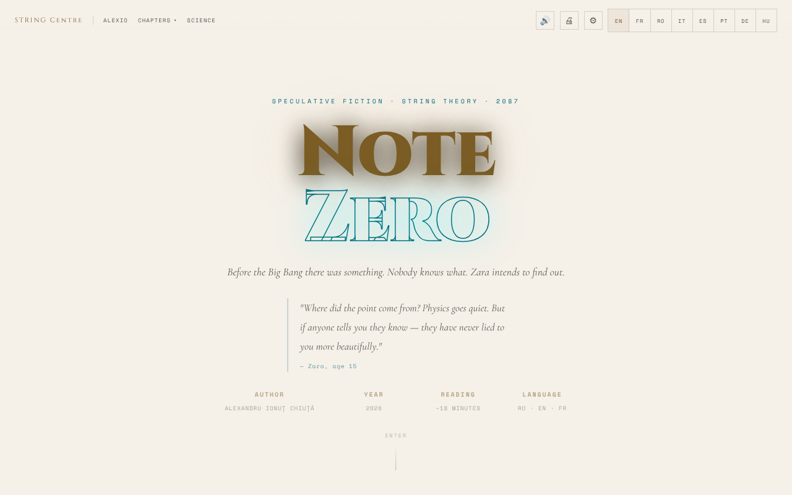

# Nota Zero

**English** · [Română](README.ro.md) · [Français](README.fr.md) · [Italiano](README.it.md) · [Español](README.es.md) · [Português](README.pt.md) · [Deutsch](README.de.md) · [Magyar](README.hu.md)

**Version:** 1.4.7 · **Last updated:** 2026-10-23

Interface languages: **Română, English, Français, Italiano, Español, Português (PT), Deutsch, Magyar**

**Fiction / speculation.** A literary work; the scientific notes are meant as explanation and do not replace academic sources.

A speculative-fiction short story about string theory, readable in 8 languages (Romanian, English, French, German, Spanish, Portuguese, Italian, Hungarian), with a voice reader and accessibility options.

**Live:** https://chiuta.github.io/Nota-Zero/

## What it is

Nota Zero is a short story by Alexandru Ionuț Chiuță (2026), presented as a single-file reading page (`index.html`). According to the page, it is "speculative fiction · string theory · 2087", with a reading time of about 18 minutes, in eight languages (RO · EN · FR · IT · ES · PT · DE · HU). It begins: "Before the Big Bang there was something. Nobody knows what. Zara intends to find out." The full text is included in the file, alongside scientific notes.

## Features

- Interface and full text in 8 languages (RO, EN, FR, IT, ES, PT, DE, HU): the story (9 chapters) and the "Scientific Notes" exist in every language; the Italian, Spanish, Portuguese, German and Hungarian translations were produced with AI assistance and have not been verified by native speakers; instant switching between languages.
- Chapters: I · The Wrong Question, Interlude · The Father, II · The Music Before Sounds, III · The Membrane, IV · Before the First Second, V · The Strings, VI · The Mirror of the Universe, VII · The Return, Epilogue · 17 May 2087, plus the "Scientific Notes" section.
- A "Chapters" menu with direct navigation; a "↑" button to return to the top; mobile menu.
- Voice reading (🔊) through the browser's speech synthesis (Web Speech API): a ▶ button at each chapter, a player with pause, stop, skipping between passages, speed (1×) and voice choice.
- Printing (🖨).
- "Resume reading": on a new visit, if you previously read further than the first chapter, a discreet bar "You left off at …" appears with Continue and Close buttons (it follows the chosen language).
- Accessibility panel (⚙): text size (A− / A+), dyslexia font (Atkinson Hyperlegible), letter/word/line/paragraph spacing, text shadow, narrow column, link underlining, high contrast, light mode, sepia mode (light beige background with brown text), no animations, reading guide, colour-blindness modes (protanopia, deuteranopia, tritanopia) and "Reset all preferences".
- A background animation (canvas) in the header, which can be disabled from "No animations".

## Other files

- `index.md` — the story's text in Markdown format (Romanian version).
- `recenzie.html` — an "Exhaustive review" of the work, **generated by an AI model (Claude Sonnet 4.6)**, not independent literary criticism; the scores (e.g. 9.4/10) are generated automatically and were not validated by a human evaluator. The label "Recenzie generată de AI / AI-generated review" is displayed bilingually (RO/EN) in the title, in the header, in the note and in the footer.
- Language limits: the review (`recenzie.html`) and the series index (`serie/index.html`) have a language selector (RO/EN/FR/IT/ES/PT/DE/HU; link `?lang=xx`; the choice is shared with the app through `nz-lang`), and the import guide `punti/README.md` exists in 8 languages (English canonical). Still **in Romanian only**: the 41 volumes (`serie/vol-*.html`, the critical apparatus, the supplementary files and the initial archive), `carte/` (the book, PDF), the data files in `punti/import/` and `index.md` (the story); the series index states this in the other languages. The translations of the review and of the import guide are automatic, not verified by native speakers, and need review (critical tone, physics terms such as ekpyrotic/bulk/brane). The review describes app v14 (RO/EN/FR) and was not updated to the 8 languages of the app.

## The complete series (41 volumes)

Besides the story in `index.html` (volume I), the repository contains the *Nota Zero* series in Romanian:

- `serie/` — the final edition (19 files, 41 volumes), with `index.html` as the table of contents. It starts at `serie/index.html`.
- `serie/arhiva-initiala/` — the initial series, with the volumes by theme, and the 10 critical analyses (generated by an AI model).
- `serie/suplimentare/` — *Nota Muzicii* (Vol. XVII-A), ten prose scenes, a fictional review from 2400 and the implementation guide.
- `serie/COMPARATIE.md` — the comparison between the final edition and the complete series and what was merged.
- `carte/Nota-Zero-carte-completa-ro.pdf` — the complete book, 478 pages, A5 format; `carte/Nota-Zero-carte-completa-ro.md` — all the text of the PDF, in Markdown.

The pages in `serie/` are static, with only small local scripts (background animations, progress bar), with no network calls, with one exception: two analyses in the archive (`ANALIZA-clasamente-72-indicatori.html`, `ANALIZA-recenzie-titlologica.html`) load Chart.js from cdnjs.cloudflare.com for charts (the text can be read without it). No page loads external fonts. The texts are fiction written in collaboration with Claude (Anthropic); the reviews and rankings are generated by an AI model and are not independent criticism.

## User guide

1. Open the page and choose the language with the **RO / EN / FR / IT / ES / PT / DE / HU** buttons in the top bar (or from the ☰ menu on mobile).
2. Read by scrolling, or jump to a chapter from the "Chapters" menu; "Science" takes you to the "Scientific Notes".
3. For listening: press 🔊 in the bar or ▶ next to a chapter's title. While playback is on, **Space** pauses/resumes and **Esc** stops.
4. From ⚙ Accessibility you set the text size, font, spacing, contrast, colour modes and more; the preferences are saved automatically.
5. Use 🖨 to print the text.
6. In the drop-down menus, the ↑ / ↓ arrows move the selection, Esc closes, Tab closes the menu.

## Privacy and network

- **Local storage (localStorage):** the language (`nz-lang`), the text size (`nz-fz`), the accessibility preferences (`nz-a11y-*`, `nz-cb`), the last chapter reached (`nz-pos`), the reading speed and voice (`nz-tts-speed`, `nz-tts-voice-*`). The text and other personal data are not stored. The notes you write yourself (📝) are the exception: they are kept only in your browser (key `fff.nota-zero.notes`), can be deleted and are exported only if you ask for it.
- **Network:** I found no `fetch`/XHR calls and no scripts or fonts loaded from external servers. The links to centrulstring.ro, alexio.tf, Buy Me a Coffee and chiuta.github.io open only on click.
- Voice reading uses the voices installed in the browser/system; some browsers may send the text to their own voice service, depending on the chosen voice (browser behaviour, not the app's).

## Running locally / offline

Download `index.html` and open it in a browser; the text, accessibility and printing need no internet. The voice reader depends on the voices available locally in the browser/system.

## License

MIT — see the LICENSE file

## Audit

Audit: 2026-10-10 (updated 2026-10-11) — no `fetch`/XHR/CDN; the only network exit is on clicking links. Accessibility fixes (labels for the toggles in the accessibility panel, contrast in light themes, dark-background panels in light mode).

## Search and notes (since v1.1.0)

- **Local search in the text** (the 🔎 button, FFF.search): searches the chapter paragraphs in the active language (ro, en, fr, it, es, pt, de, hu), without diacritics and with small typos, then jumps to the passage. No network.
- **Bookmarks and notes** (the 📝 button): you select a passage, add a note; they are kept only in the browser, can be deleted, exported as Markdown and are included in the .fff.json backup (from "Transparency").
- Reading chapters aloud, as before, remains unchanged; shared kit (core, label, bundle, tts, search).
- The new texts are in all 8 languages of the app (ro, en, fr, it, es, pt, de, hu); the automatic translations are not natively verified.
- Tests: `tests/fff-r8.test.mjs` (network blocked, 1280 and 360 px, axe 0 violations with dialogs open, notes added/persisted/deleted/exported).

## History / Changelog

### 1.4.7 — 2026-10-23

- Dialogs: the native `alert`/`confirm`/`prompt` boxes were replaced with accessible, translated `FFF.dialog` dialogs (keyboard, focus trap, Escape) with the same behavior (fff-kit 1.2.0).

### 1.4.5 — 2026-10-22

fff-kit 1.1.4: touch targets and minimum text size; touch targets and text size corrected.

- 1.4.4 — 2026-10-22: fff-kit 1.1.2: PBKDF2 600,000 iterations, anti-clickjacking protection
- **21 October 2026 (version 1.4.1):** `recenzie.html` and `serie/index.html` get a language selector (8 languages, `?lang=xx`, shared `nz-lang` key) and `punti/README.md` is available in 8 languages; strict CSP on these pages; the footer link to the series follows the current language. The 41 volumes stay in Romanian.
- **19 October 2026 (version 1.4.0):** the local search and the bookmarks/notes described above (introduced in 1.1.0) are present in the current version: they had been removed by mistake in an earlier cleanup and were reimplemented (search over all 8 languages; notes with Markdown export and inclusion in the `.fff.json` backup; tests in `tests/fff-r8.test.mjs`). The story (9 chapters), the "Scientific Notes" and the interface are available in 8 languages (Italian, Spanish, Portuguese, German and Hungarian added to Romanian, English and French).

- **19 October 2026 (version 1.2.0):** in "Scientific Notes", links to Horizons (Cyclic universe, Cosmic microwave background) and Universul-Observabil-3D; ro/en/fr texts.

- **18 October 2026:** added the complete series (`serie/`), the initial archive, the supplementary materials and the book's PDF; in the final edition, books II–V have the full text in place of the summaries (see `serie/COMPARATIE.md`). The app in `index.html` did not change.

- **18 October 2026:** deep links `?cap=1…7`, `?cap=epilog` and `?cap=science` (equivalent to `#capN`; the hash takes priority; invalid values are ignored). A "Bridges to other apps" section in `serie/` and import files in `punti/`. CSP: hash recalculated.
- **18 October 2026 (version 1.1.1):** `?cap=1b` (Interlude) and focus on the target chapter at `?cap=`; honest labels for the TerRa/ORARIUM bridges in `serie/` (illustrative place and time, orbital time), the Earth "high in the lunar sky" (≈31° elevation) in Vol. I, the archive note, the bridges → GitHub link; corrected import files (BorderlessMelodies, Akasha, CalmWaves ≤ 8 presets).
- **14 October 2026 (version 1.1.0):** local search in the text, exportable bookmarks and notes, shared kit, tests.

- **12 October 2026 (version 1.0.0):** 1.0.0 — 2026-10-12: the version and the date of the last update are shown in the app (footer, translated RO/EN/FR).

- **11 October 2026 (rev. 3):** the attribution of the quote in the header no longer touches the AUTHOR/YEAR row on desktop (margin under the quote); the progress bar also exposes the estimated remaining time (`aria-valuetext`, ~18 min total, RO/EN/FR) and no longer produces NaN on pages without scrolling. CSP: hash recalculated.
- **11 October 2026 (rev. 2):** the 82 inline `onclick`/`onchange` handlers were replaced by a delegated dispatcher (`data-onclick`/`data-onchange`, literal arguments, whitelist of functions); the CSP now has `script-src` with a hash and without `'unsafe-inline'`. The text size (A−/A+) was applied only partially in the chapter paragraphs at ≥1100 px and on mobile; now it scales everywhere. Activating an option (e.g. dyslexia) no longer switches the theme from light (system) to dark. New: "Resume reading".
- **11 October 2026:** sepia mode gave a dark background (rgb(26,20,16)); it is now a warm light theme (background #f4e8d0, brown text #3b2a14). The progress bar and the support buttons are now in ARIA landmarks (`complementary`), so axe-core reports 0 violations (the `region` rule) at 1280 and 360 px. Unchanged: 82 inline `onclick` handlers (the CSP keeps `'unsafe-inline'`). The section "What remains unknown · May 2026" keeps its date; I found no new experimental confirmation of string theory, the graviton or extra dimensions at this date.

## Author

Alexio — Alexandru-Ionuț Chiuță, contact: alexio@trom.tf. The page links to Centrul STRING (centrulstring.ro).

## English summary

Nota Zero is a speculative-fiction short story about string theory by Alexandru Ionuț Chiuță, presented as a single-file reading page in 8 languages (Romanian, English, French, German, Spanish, Portuguese, Italian, Hungarian) (about 18 minutes). It has chapter navigation, scientific notes, browser text-to-speech reading, printing and a wide accessibility panel (dyslexia font, spacing, contrast, sepia, colour-blind modes). Preferences are kept in localStorage; no network requests. MIT licence.

### 1.4.3 — 2026-10-22
- The resume bar, the mobile menu and the print button are now labelled in the current language, and the audio “now reading” chapter title follows the selected language instead of the Romanian one.

### 1.4.2 — 2026-10-22
- Audio reading controls (panel, buttons, voice selector, announcements) and the fiction notice in the footer are now translated into all 8 languages.

