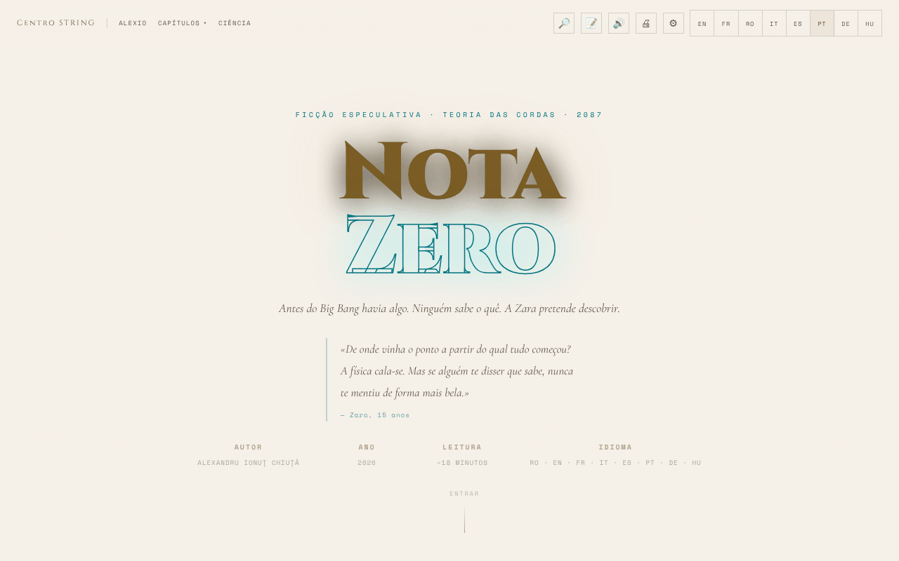

# Nota Zero

[English](README.md) · [Română](README.ro.md) · [Français](README.fr.md) · [Italiano](README.it.md) · [Español](README.es.md) · **Português** · [Deutsch](README.de.md) · [Magyar](README.hu.md)

**Versão:** 2.0.0 · **Última atualização:** 2026-10-26

Idiomas da interface: **Română, English, Français, Italiano, Español, Português (PT), Deutsch, Magyar**

**Ficção / especulação.** Obra literária; as notas científicas têm finalidade explicativa e não substituem as fontes académicas.

Conto de ficção especulativa sobre a teoria das cordas, legível em 8 línguas (romeno, inglês, francês, alemão, espanhol, português, italiano, húngaro), com leitor de voz e opções de acessibilidade.

**Online:** https://chiuta.github.io/Nota-Zero/

## O que é

Nota Zero é um conto de Alexandru Ionuț Chiuță (2026), apresentado como uma página de leitura de ficheiro único (`index.html`). Segundo a página, é «ficção especulativa · teoria das cordas · 2087», com uma leitura de cerca de 18 minutos, em oito línguas (RO · EN · FR · IT · ES · PT · DE · HU). Começa assim: «Antes do Big Bang havia algo. Ninguém sabe o quê. A Zara pretende descobrir.» O texto integral está incluído no ficheiro, juntamente com notas científicas.

## Funcionalidades

- Interface e texto completo em 8 línguas (RO, EN, FR, IT, ES, PT, DE, HU): o conto (9 capítulos) e as «Notas científicas» existem em cada língua; as traduções para italiano, espanhol, português, alemão e húngaro foram feitas com ajuda de IA e não foram verificadas por falantes nativos; alternância instantânea entre línguas.
- Capítulos: I · A Pergunta Errada, Interlúdio · O Pai, II · A Música Antes dos Sons, III · A Membrana, IV · Antes do Primeiro Segundo, V · As Cordas, VI · O Espelho do Universo, VII · O Regresso, Epílogo · 17 de maio de 2087, mais a secção «Notas científicas».
- Menu «Capítulos» com navegação direta; botão «↑» para voltar ao topo; menu móvel.
- Leitura em voz alta (🔊) através da síntese de voz do navegador (Web Speech API): botão ▶ em cada capítulo, leitor com pausa, paragem, salto entre fragmentos, velocidade (1×) e escolha da voz.
- Impressão (🖨).
- «Retomar a leitura»: numa nova visita, se anteriormente leu para além do primeiro capítulo, aparece uma barra discreta «Ficou em …» com os botões Continuar e Fechar (acompanha a língua escolhida).
- Painel de acessibilidade (⚙): tamanho do texto (A− / A+), tipo de letra para dislexia (Atkinson Hyperlegible), espaçamento de letras/palavras/linhas/parágrafos, sombra do texto, coluna estreita, sublinhado das ligações, contraste elevado, modo claro, modo sépia (fundo bege claro com texto castanho), sem animações, guia de leitura, modos para daltonismo (protanopia, deuteranopia, tritanopia) e «Repor todas as preferências».
- Animação de fundo (canvas) no cabeçalho, que pode ser desativada em «Sem animações».

## Outros ficheiros

- `index.md` — o texto do conto em formato Markdown (versão em romeno).
- `recenzie.html` — uma «Recensão exaustiva» da obra, **gerada por um modelo de IA (Claude Sonnet 4.6)**, não crítica literária independente; as pontuações (p. ex. 9,4/10) são geradas automaticamente e não foram validadas por um avaliador humano. A etiqueta «Recenzie generată de AI / AI-generated review» é apresentada em forma bilingue (RO/EN) no título, no cabeçalho, na nota e no rodapé.
- Limites de idioma: a recensão (`recenzie.html`) e o índice da série (`serie/index.html`) têm seletor de idioma (RO/EN/FR/IT/ES/PT/DE/HU; ligação `?lang=xx`; a escolha é partilhada com a aplicação através de `nz-lang`), e o guia de importação `punti/README.md` existe em 8 idiomas (o inglês é canónico). Continuam **só em romeno**: os 41 volumes (`serie/vol-*.html`, o aparato crítico, os ficheiros suplementares e o arquivo inicial), `carte/` (o livro, PDF), os ficheiros de dados de `punti/import/` e `index.md` (a narrativa); o índice da série di-lo nos outros idiomas. As traduções da recensão e do guia de importação são automáticas, não verificadas por falantes nativos, e precisam de revisão (tom crítico, termos de física como ekpyrotic/bulk/brane). A recensão descreve a aplicação v14 (RO/EN/FR) e não foi atualizada para os 8 idiomas da aplicação.

## A série completa (41 volumes)

Além do conto de `index.html` (volume I), o repositório contém a série *Nota Zero* em romeno:

- `serie/` — a edição final (19 ficheiros, 41 volumes), com `index.html` como índice. Começa em `serie/index.html`.
- `serie/arhiva-initiala/` — a série inicial, com os volumes por temas, e as 10 análises críticas (geradas por um modelo de IA).
- `serie/suplimentare/` — *Nota Muzicii* (Vol. XVII-A), dez cenas em prosa, uma recensão fictícia do ano 2400 e o guia de implementação.
- `serie/COMPARATIE.md` — a comparação entre a edição final e a série completa e o que foi fundido.
- `carte/Nota-Zero-carte-completa-ro.pdf` — o livro completo, 478 páginas, formato A5; `carte/Nota-Zero-carte-completa-ro.md` — todo o texto do PDF, em Markdown.

As páginas de `serie/` são estáticas, com apenas pequenos scripts locais (animações de fundo, barra de progresso), sem chamadas de rede, com uma exceção: duas análises do arquivo (`ANALIZA-clasamente-72-indicatori.html`, `ANALIZA-recenzie-titlologica.html`) carregam o Chart.js a partir de cdnjs.cloudflare.com para os gráficos (o texto lê-se também sem ele). Nenhuma página carrega tipos de letra externos. Os textos são ficção escrita em colaboração com o Claude (Anthropic); as recensões e as classificações são geradas por um modelo de IA e não são crítica independente.

## Manual de utilização

1. Abra a página e escolha a língua com os botões **RO / EN / FR / IT / ES / PT / DE / HU** da barra superior (ou no menu ☰ no telemóvel).
2. Leia deslocando a página, ou salte para um capítulo a partir do menu «Capítulos»; «Ciência» leva às «Notas científicas».
3. Para ouvir: prima 🔊 na barra ou ▶ junto ao título de um capítulo. Com a reprodução ativa, **Espaço** coloca em pausa/retoma e **Esc** pára.
4. Em ⚙ Acessibilidade define o tamanho do texto, o tipo de letra, o espaçamento, o contraste, os modos de cor e mais; as preferências são guardadas automaticamente.
5. Use 🖨 para imprimir o texto.
6. Nos menus pendentes, as setas ↑ / ↓ movem a seleção, Esc fecha, Tab fecha o menu.

## Privacidade e rede

- **Armazenamento local (localStorage):** a língua (`nz-lang`), o tamanho do texto (`nz-fz`), as preferências de acessibilidade (`nz-a11y-*`, `nz-cb`), o último capítulo alcançado (`nz-pos`), a velocidade e a voz da leitura (`nz-tts-speed`, `nz-tts-voice-*`). O texto e outros dados pessoais não são guardados. As notas que escreve (📝) são a exceção: ficam guardadas apenas no seu navegador (chave `fff.nota-zero.notes`), podem ser apagadas e só são exportadas se o pedir.
- **Rede:** não encontrei chamadas `fetch`/XHR nem scripts ou tipos de letra carregados de servidores externos. As ligações para centrulstring.ro, alexio.tf, Buy Me a Coffee e chiuta.github.io só se abrem ao clicar.
- A leitura em voz alta usa as vozes instaladas no navegador/sistema; alguns navegadores podem enviar o texto a um serviço de voz próprio, consoante a voz escolhida (comportamento do navegador, não da aplicação).

## Execução local / offline

Transfira `index.html` e abra-o num navegador; o texto, a acessibilidade e a impressão não precisam de Internet. O leitor de voz depende das vozes disponíveis localmente no navegador/sistema.

## Licença

MIT — veja o ficheiro LICENSE

## Auditoria

Auditoria: 2026-10-10 (atualizada a 2026-10-11) — sem `fetch`/XHR/CDN; a única saída para a rede é ao clicar em ligações. Correções de acessibilidade (etiquetas para os interruptores do painel de acessibilidade, contraste nos temas claros, painéis com fundo escuro no modo claro).

## Pesquisa e notas (desde a v1.1.0)

- **Pesquisa local no texto** (botão 🔎, FFF.search): pesquisa nos parágrafos dos capítulos da língua ativa (ro, en, fr, it, es, pt, de, hu), sem distinguir sinais diacríticos e com pequenos erros, e depois salta para a passagem. Sem rede.
- **Marcadores e notas** (botão 📝): seleciona um fragmento, adiciona uma nota; ficam guardados apenas no navegador, podem ser apagados, exportados como Markdown e entram na cópia de segurança .fff.json (a partir de «Transparência»).
- A leitura em voz alta dos capítulos, já existente, mantém-se inalterada; kit comum (core, label, bundle, tts, search).
- Os novos textos estão nas 8 línguas da aplicação (ro, en, fr, it, es, pt, de, hu); as traduções automáticas não estão verificadas por falantes nativos.
- Testes: `tests/fff-r8.test.mjs` (rede bloqueada, 1280 e 360 px, axe 0 violações com os diálogos abertos, notas adicionadas/mantidas/apagadas/exportadas).

## Histórico / Changelog

### 1.4.8 — 2026-10-23

- Pré-visualização social: `og:image` apontava para um ficheiro inexistente (`og-image.jpg`, HTTP 404); agora aponta para `screenshot.png`.

### 1.4.7 — 2026-10-23

- Diálogos: as caixas nativas `alert`/`confirm`/`prompt` foram substituídas por diálogos `FFF.dialog` acessíveis e traduzidos (teclado, armadilha de foco, Esc), com o mesmo comportamento (fff-kit 1.2.0).

### 1.4.5 — 2026-10-22

fff-kit 1.1.4: alvos de toque e tamanho mínimo do texto; alvos de toque e texto corrigidos.

- 1.4.4 — 2026-10-22: fff-kit 1.1.2: PBKDF2 com 600.000 iterações, proteção anti-clickjacking
- **21 de outubro de 2026 (versão 1.4.1):** `recenzie.html` e `serie/index.html` recebem um seletor de idioma (8 idiomas, `?lang=xx`, chave comum `nz-lang`) e `punti/README.md` está disponível em 8 idiomas; CSP estrita nestas páginas; a ligação do rodapé para a série segue o idioma atual. Os 41 volumes continuam em romeno.
- **19 de outubro de 2026 (versão 1.4.0):** a pesquisa local e os marcadores/notas descritos acima (introduzidos na 1.1.0) estão presentes na versão atual: tinham sido removidos por engano numa limpeza anterior e foram reimplementados (pesquisa nas 8 línguas; notas com exportação para Markdown e incluídas na cópia `.fff.json`; testes em `tests/fff-r8.test.mjs`). O conto (9 capítulos), as «Notas científicas» e a interface estão disponíveis em 8 línguas (italiano, espanhol, português, alemão e húngaro acrescentados a romeno, inglês e francês).

- **19 de outubro de 2026 (versão 1.2.0):** nas «Notas científicas», ligações para Horizons (Universo cíclico, Fundo cósmico de micro-ondas) e para Universul-Observabil-3D; textos ro/en/fr.

- **18 de outubro de 2026:** adicionadas a série completa (`serie/`), o arquivo inicial, os materiais suplementares e o PDF do livro; na edição final, os livros II–V têm o texto integral em vez dos resumos (ver `serie/COMPARATIE.md`). A aplicação de `index.html` não mudou.

- **18 de outubro de 2026:** ligações profundas `?cap=1…7`, `?cap=epilog` e `?cap=science` (equivalentes a `#capN`; o hash tem prioridade; os valores inválidos são ignorados). Secção «Pontes para outras aplicações» em `serie/` e ficheiros de importação em `punti/`. CSP: hash recalculado.
- **18 de outubro de 2026 (versão 1.1.1):** `?cap=1b` (Interlúdio) e foco no capítulo de destino com `?cap=`; etiquetas honestas para as pontes TerRa/ORARIUM de `serie/` (local e hora ilustrativos, tempo orbital), a Terra «alta no céu lunar» (≈31° de elevação) no Vol. I, a nota de arquivo, a ligação pontes → GitHub; ficheiros de importação corrigidos (BorderlessMelodies, Akasha, CalmWaves ≤ 8 predefinições).
- **14 de outubro de 2026 (versão 1.1.0):** pesquisa local no texto, marcadores e notas exportáveis, kit comum, testes.

- **12 de outubro de 2026 (versão 1.0.0):** 1.0.0 — 2026-10-12: a versão e a data da última atualização são apresentadas na aplicação (rodapé, traduzida RO/EN/FR).

- **11 de outubro de 2026 (rev. 3):** a atribuição da citação do cabeçalho já não toca na linha AUTOR/ANO no computador (margem sob a citação); a barra de progresso expõe também o tempo restante estimado (`aria-valuetext`, ~18 min no total, RO/EN/FR) e já não produz NaN em páginas sem deslocação. CSP: hash recalculado.
- **11 de outubro de 2026 (rev. 2):** os 82 handlers `onclick`/`onchange` em linha foram substituídos por um despachante delegado (`data-onclick`/`data-onchange`, argumentos literais, lista branca de funções); a CSP tem agora `script-src` com hash e sem `'unsafe-inline'`. O tamanho do texto (A−/A+) aplicava-se apenas parcialmente nos parágrafos dos capítulos a ≥1100 px e no telemóvel; agora escala em todo o lado. Ativar uma opção (p. ex. dislexia) já não muda o tema de claro (do sistema) para escuro. Novidade: «Retomar a leitura».
- **11 de outubro de 2026:** o modo sépia dava um fundo escuro (rgb(26,20,16)); agora é um tema claro quente (fundo #f4e8d0, texto castanho #3b2a14). A barra de progresso e os botões de apoio estão agora em pontos de referência ARIA (`complementary`), pelo que o axe-core reporta 0 violações (regra `region`) a 1280 e 360 px. Inalterado: 82 handlers `onclick` em linha (a CSP mantém `'unsafe-inline'`). A secção «O que continua desconhecido · Maio de 2026» mantém a sua data; não encontrei qualquer nova confirmação experimental da teoria das cordas, do gravitão ou das dimensões extra nesta data.

## Autor

Alexio — Alexandru-Ionuț Chiuță, contacto: alexio@trom.tf. A página remete para o Centrul STRING (centrulstring.ro).

## Resumo
Nota Zero é um conto de ficção especulativa sobre a teoria das cordas de Alexandru Ionuț Chiuță, apresentado como uma página de leitura de ficheiro único em 8 línguas (romeno, inglês, francês, alemão, espanhol, português, italiano, húngaro) (cerca de 18 minutos). Oferece navegação por capítulos, notas científicas, leitura em voz alta com a síntese de voz do navegador, impressão e um amplo painel de acessibilidade (tipo de letra para dislexia, espaçamento, contraste, sépia, modos para daltonismo). As preferências são guardadas em localStorage; sem pedidos de rede. Licença MIT.

### 1.4.3 — 2026-10-22
- A barra de retoma, o menu móvel e o botão de imprimir têm agora etiquetas no idioma atual, e o título do capítulo «a ler agora» (áudio) segue o idioma escolhido em vez do romeno.

### 1.4.2 — 2026-10-22
- Os controlos de leitura áudio (painel, botões, seletor de voz, avisos) e a nota de ficção no rodapé estão traduzidos nos 8 idiomas.

