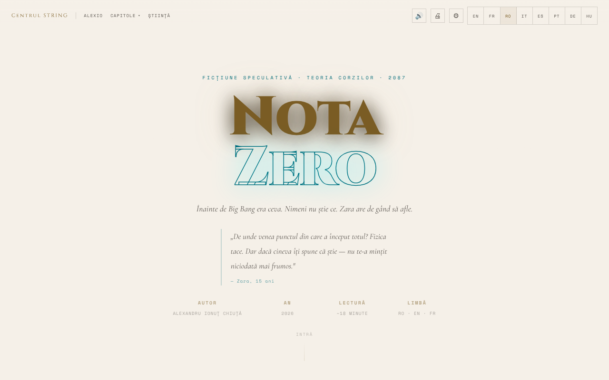

# Nota Zero

[English](README.md) · **Română** · [Français](README.fr.md) · [Italiano](README.it.md) · [Español](README.es.md) · [Português](README.pt.md) · [Deutsch](README.de.md) · [Magyar](README.hu.md)

**Versiune:** 1.4.0 · **Ultima actualizare:** 2026-10-19

Limbile interfeței: **Română, English, Français, Italiano, Español, Português (PT), Deutsch, Magyar**

**Ficțiune / speculație.** Operă literară; notele științifice au scop explicativ și nu înlocuiesc surse academice.

Povestire de ficțiune speculativă despre teoria corzilor, citibilă în română, engleză și franceză, cu cititor vocal și opțiuni de accesibilitate.

**Live:** https://chiuta.github.io/Nota-Zero/

## Ce este

Nota Zero este o povestire de Alexandru Ionuț Chiuță (2026), prezentată ca o pagină de lectură single-file (`index.html`). Conform paginii, este „ficțiune speculativă · teoria corzilor · 2087”, cu o lectură de aproximativ 18 minute, în trei limbi (RO · EN · FR). Începe cu: „Înainte de Big Bang era ceva. Nimeni nu știe ce. Zara are de gând să afle.” Textul integral este inclus în fișier, alături de note științifice.

## Funcții

- Interfață în 8 limbi (RO, EN, FR, IT, ES, PT, DE, HU); text complet în română, engleză și franceză (în celelalte limbi se afișează textul în engleză); comutare instantanee între limbi.
- Capitole: I · Întrebarea Greșită, Interludiu · Tatăl, II · Muzica Înainte de Sunete, III · Membrana, IV · Înainte de Prima Secundă, V · Corzile, VI · Oglinda Universului, VII · Întoarcerea, Epilog · 17 Mai 2087, plus secțiunea „Note Științifice”.
- Meniu „Capitole” cu navigare directă; buton „↑” pentru revenirea sus; meniu mobil.
- Citire cu voce (🔊) prin sinteza vocală a browserului (Web Speech API): buton ▶ la fiecare capitol, player cu pauză, oprire, salt între fragmente, viteză (1×) și alegerea vocii.
- Imprimare (🖨).
- „Reia lectura”: la o nouă vizită, dacă ai citit anterior mai departe de primul capitol, apare o bară discretă „Ai rămas la …” cu butoanele Continuă și Închide (urmărește limba aleasă).
- Panou de accesibilitate (⚙): mărime text (A− / A+), font pentru dislexie (Atkinson Hyperlegible), spațiere litere/cuvinte/rânduri/paragrafe, umbră text, coloană îngustă, subliniere linkuri, contrast ridicat, mod luminos, mod sepia (fundal bej deschis cu text brun), fără animații, ghid de lectură, moduri pentru daltonism (protanopie, deuteranopie, tritanopie) și „Resetează toate preferințele”.
- Animație de fundal (canvas) în antet, care poate fi dezactivată din „Fără animații”.

## Alte fișiere

- `index.md` — textul poveștii în format Markdown (versiune în română).
- `recenzie.html` — „Recenzie exhaustivă” a lucrării, **generată de un model AI (Claude Sonnet 4.6)**, nu critică literară independentă; scorurile (ex. 9,4/10) sunt generate automat și nu au fost validate de un evaluator uman. Eticheta „Recenzie generată de AI / AI-generated review” este afișată bilingv (RO/EN) în titlu, în antet, în notă și în subsol.

## Seria completă (41 de volume)

Pe lângă povestirea din `index.html` (volumul I), depozitul conține seria *Nota Zero* în română:

- `serie/` — ediția finală (19 fișiere, 41 de volume), cu `index.html` ca cuprins. Începe la `serie/index.html`.
- `serie/arhiva-initiala/` — seria inițială, cu volumele pe teme, și cele 10 analize critice (generate de un model AI).
- `serie/suplimentare/` — *Nota Muzicii* (Vol. XVII-A), zece scene în proză, o recenzie ficțională din 2400 și ghidul de implementare.
- `serie/COMPARATIE.md` — comparația dintre ediția finală și seria completă și ce s-a îmbinat.
- `carte/Nota-Zero-carte-completa-ro.pdf` — cartea completă, 478 de pagini, format A5; `carte/Nota-Zero-carte-completa-ro.md` — tot textul din PDF, în Markdown.

Paginile din `serie/` sunt statice, cu doar scripturi locale mici (animații de fundal, bară de progres), fără apeluri de rețea, cu o excepție: două analize din arhivă (`ANALIZA-clasamente-72-indicatori.html`, `ANALIZA-recenzie-titlologica.html`) încarcă Chart.js de la cdnjs.cloudflare.com pentru grafice (textul se citește și fără). Nicio pagină nu încarcă fonturi externe. Textele sunt ficțiune scrisă în colaborare cu Claude (Anthropic); recenziile și clasamentele sunt generate de un model AI și nu sunt critică independentă.

## Manual de utilizare

1. Deschide pagina și alege limba cu butoanele **RO / EN / FR / IT / ES / PT / DE / HU** din bara de sus (sau din meniul ☰ pe mobil).
2. Citește derulând, sau sari la un capitol din meniul „Capitole”; „Știință” duce la „Note Științifice”.
3. Pentru ascultare: apasă 🔊 din bară sau ▶ lângă titlul unui capitol. Cu redarea pornită, **Spațiu** pune pe pauză/reia, iar **Esc** oprește.
4. Din ⚙ Accesibilitate setezi mărimea textului, fontul, spațierea, contrastul, modurile de culoare și altele; preferințele se salvează automat.
5. Folosește 🖨 pentru a imprima textul.
6. În meniurile derulante, săgețile ↑ / ↓ mută selecția, Esc închide, Tab închide meniul.

## Confidențialitate și rețea

- **Stocare locală (localStorage):** limba (`nz-lang`), mărimea textului (`nz-fz`), preferințele de accesibilitate (`nz-a11y-*`, `nz-cb`), ultimul capitol atins (`nz-pos`), viteza și vocea citirii (`nz-tts-speed`, `nz-tts-voice-*`). Nu se stochează textul sau alte date personale.
- **Rețea:** nu am găsit apeluri `fetch`/XHR și nici scripturi sau fonturi încărcate de pe servere externe. Linkurile către centrulstring.ro, alexio.tf, Buy Me a Coffee și chiuta.github.io se deschid doar la click.
- Citirea cu voce folosește vocile instalate în browser/sistem; unele browsere pot trimite textul unui serviciu vocal propriu, în funcție de vocea aleasă (comportament al browserului, nu al aplicației).

## Rulare locală / offline

Descarcă `index.html` și deschide-l în browser; textul, accesibilitatea și imprimarea nu au nevoie de internet. Cititorul vocal depinde de vocile disponibile local în browser/sistem.

## Licență

MIT — vezi fișierul LICENSE

## Audit

Audit: 2026-10-10 (actualizat 2026-10-11) — fără `fetch`/XHR/CDN; singura ieșire către rețea este la click pe linkuri. Corecturi de accesibilitate (etichete pentru comutatoarele din panoul de accesibilitate, contrast în teme luminoase, panouri cu fundal închis în modul luminos).

## Funcții noi (v1.1.0)

- **Căutare locală în text** (butonul 🔎, FFF.search): caută în paragrafele capitolelor din limba activă (ro, en, fr), fără diacritice și cu mici greșeli, apoi sare la pasaj. Fără rețea.
- **Marcaje și note** (butonul 📝): selectezi un fragment, adaugi o notă; se păstrează doar în browser, se pot șterge, exporta ca Markdown și intră în copia de siguranță .fff.json (din „Transparență”).
- Citirea capitolelor cu voce existentă rămâne neschimbată; kit comun (core, label, bundle, tts, search).
- Textele noi sunt în toate limbile aplicației (inclusiv hu/de unde există sistem i18n); traducerile automate sunt neverificate nativ.
- Teste: `tests/fff-r8.test.mjs` (rețea blocată, 1280 și 360 px, axe 0 violări cu dialogurile deschise, note adăugate/persistate/șterse/exportate).

## Istoric / Changelog

- **19 octombrie 2026 (versiunea 1.2.0):** în „Note Științifice”, linkuri spre Horizons (Universul ciclic, Radiația cosmică fosilă) și Universul-Observabil-3D; texte ro/en/fr.

- **18 octombrie 2026:** adăugate seria completă (`serie/`), arhiva inițială, materialele suplimentare și PDF-ul cărții; în ediția finală, cărțile II–V au textul integral în locul rezumatelor (vezi `serie/COMPARATIE.md`). Aplicația din `index.html` nu s-a schimbat.

- **18 octombrie 2026:** linkuri adânci `?cap=1…7`, `?cap=epilog` și `?cap=science` (echivalente cu `#capN`; hash-ul are prioritate; valorile invalide sunt ignorate). Secțiune „Punți către alte aplicații” în `serie/` și fișiere de import în `punti/`. CSP: hash recalculat.
- **18 octombrie 2026 (versiunea 1.1.1):** `?cap=1b` (Interludiu) și focus pe capitolul-țintă la `?cap=`; etichete cinstite pentru punțile TerRa/ORARIUM din `serie/` (loc și oră ilustrative, timp orbital), Pământul „sus pe cerul selenar” (≈31° elevație) în Vol. I, nota de arhivă, linkul punți → GitHub; fișiere de import corectate (BorderlessMelodies, Akasha, CalmWaves ≤ 8 presetări).
- **14 octombrie 2026 (versiunea 1.1.0):** căutare locală în text, marcaje și note exportabile, kit comun, teste.

- **12 octombrie 2026 (versiunea 1.0.0):** 1.0.0 — 2026-10-12: versiunea și data ultimei actualizări sunt afișate în aplicație (subsol, tradusă RO/EN/FR).

- **11 octombrie 2026 (rev. 3):** atribuirea citatului din antet nu mai atinge rândul AUTOR/AN pe desktop (margine sub citat); bara de progres expune și timpul rămas estimat (`aria-valuetext`, ~18 min total, RO/EN/FR) și nu mai produce NaN pe pagini fără derulare. CSP: hash recalculat.
- **11 octombrie 2026 (rev. 2):** cele 82 de handlere `onclick`/`onchange` inline au fost înlocuite cu un dispatcher delegat (`data-onclick`/`data-onchange`, argumente literale, listă albă de funcții); CSP are acum `script-src` cu hash și fără `'unsafe-inline'`. Mărimea textului (A−/A+) se aplica doar parțial în paragrafele capitolelor la ≥1100 px și pe mobil; acum scalează peste tot. Activarea unei opțiuni (ex. dislexie) nu mai schimbă tema din luminoasă (a sistemului) în întunecată. Nou: „Reia lectura”.
- **11 octombrie 2026:** modul sepia dădea un fundal închis (rgb(26,20,16)); acum este o temă caldă deschisă (fundal #f4e8d0, text brun #3b2a14). Bara de progres și butoanele de sprijin sunt acum în repere ARIA (`complementary`), deci axe-core raportează 0 violări (regula `region`) la 1280 și 360 px. Neschimbat: 82 de handlere `onclick` inline (CSP păstrează `'unsafe-inline'`). Secțiunea „Ce rămâne necunoscut · Mai 2026” păstrează data ei; nu am găsit o confirmare experimentală nouă a teoriei corzilor, gravitonului sau dimensiunilor extra la această dată.

## Autor

Alexio — Alexandru-Ionuț Chiuță, contact: alexio@trom.tf. Pagina trimite către Centrul STRING (centrulstring.ro).

## Rezumat

Nota Zero este o povestire de ficțiune speculativă despre teoria corzilor de Alexandru Ionuț Chiuță, prezentată ca pagină de lectură într-un singur fișier în română, engleză și franceză (aproximativ 18 minute). Are navigare pe capitole, note științifice, citire cu sinteză vocală a browserului, tipărire și un panou larg de accesibilitate (font pentru dislexie, spațiere, contrast, sepia, moduri pentru daltonism). Preferințele se păstrează în localStorage; fără cereri de rețea. Licență MIT.
